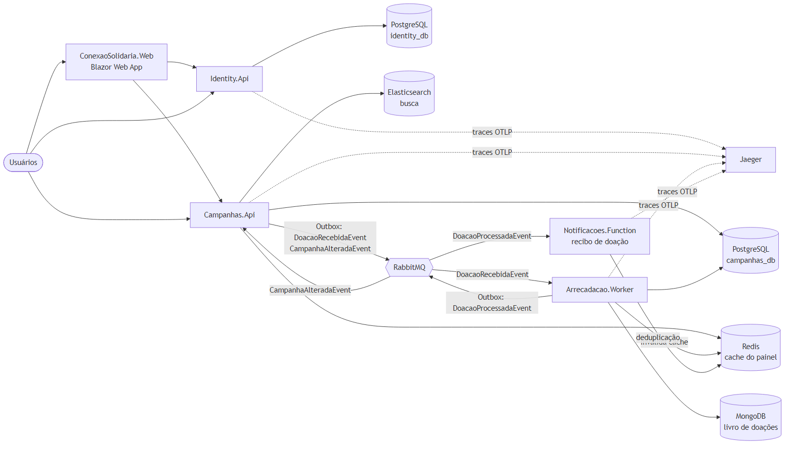

# Conexão Solidária

[](https://github.com/vkhydra/ConexaoSolidaria/actions/workflows/ci.yml)

**Atividade Substitutiva da Fase 3** da PósTech FIAP — Arquitetura de Sistemas .NET com Azure: assegurar a qualidade de software de uma API .NET com **testes unitários** (casos de sucesso e de erro) e uma **pipeline de CI que executa os testes e retorna a cobertura** ([feature 009](specs/features/009-ci-testes-cobertura/spec.md)).

A API escolhida é a **Conexão Solidária**, plataforma de doações para a ONG Esperança Solidária, que aplica o conteúdo das 5 fases do curso.

> **Status:** as 8 funcionalidades, os testes unitários e a pipeline de CI estão implementados; a stack completa sobe com `docker compose`. Kubernetes, gateway e observabilidade avançada (Fases 10 a 14 do [roadmap](specs/roadmap.md)) ficaram fora desta entrega.

## Testes e cobertura (requisito avaliado)

| Item | Onde |
|---|---|
| Testes unitários (xUnit), sucesso e erro | [`tests/unit/`](tests/unit/README.md) |
| Pipeline de CI (GitHub Actions) | [`.github/workflows/ci.yml`](.github/workflows/ci.yml): job `testes-unitarios` (avaliado) e job `testes-integracao` (todos os testes e cobertura mínima de 90%) |
| Cobertura | Resumo na página de cada execução e artefato `cobertura-testes-unitarios` para download ([contrato da pipeline](specs/features/009-ci-testes-cobertura/contracts/pipeline.md)) |
| Rodar localmente | `dotnet test ConexaoSolidaria.slnx -c Release --filter Category=Unit` e `pwsh ./scripts/verificar-cobertura.ps1 -Minimo 90 -ExecutarTestes` (gera o relatório HTML em `coverage/index.html`) |
| Como ver a cobertura no GitHub | Aba **Actions** → execução do workflow **CI** → resumo da página (tabela de cobertura) e **Artifacts** → `cobertura-testes-unitarios` (baixar e abrir `index.html`) |

## Funcionalidades da API

| # | Feature | Acesso |
|---|---|---|
| 001 | [Autenticação JWT com as roles `GestorONG` e `Doador`](specs/features/001-autenticacao/spec.md) | — |
| 002 | [Gestão de campanhas (meta > 0, data fim não pode estar no passado)](specs/features/002-gestao-campanhas/spec.md) | `GestorONG` |
| 003 | [Cadastro de doador (e-mail único, CPF validado, senha com hash)](specs/features/003-cadastro-doador/spec.md) | Público |
| 004 | [Painel de transparência: campanhas ativas, meta e total arrecadado](specs/features/004-painel-transparencia/spec.md) | Público |
| 005 | [Doação para campanha ativa, processada de forma assíncrona](specs/features/005-doacao/spec.md) | `Doador` |
| 006 | [Busca de campanhas tolerante a erros de digitação](specs/features/006-busca-campanhas/spec.md) | Público |
| 007 | [Recibo de doação por função serverless](specs/features/007-recibo-doacao/spec.md) | — |
| 008 | [Direitos do titular (LGPD): ver e apagar os próprios dados](specs/features/008-direitos-titular/spec.md) | `Doador` |

## Arquitetura (resumo)

- **Microsserviços:** `Identity.Api`, `Campanhas.Api`, `Arrecadacao.Worker` e a função serverless `Notificacoes.Function`.
- **Mensageria:** a doação publica `DoacaoRecebidaEvent` no RabbitMQ (MassTransit com Outbox). O Worker consome o evento e atualiza o total arrecadado.
- **Dados:** PostgreSQL, MongoDB, Redis e Elasticsearch, cada um com uma [justificativa](docs/justificativa-bancos.md).
- **Infra:** Docker e docker-compose (Kubernetes e Kong estão especificados, mas não fazem parte desta entrega).
- **Observabilidade:** OpenTelemetry com traces no Jaeger, health checks e métricas `/metrics`.
- **CI:** GitHub Actions faz build, testes, cobertura e publica o relatório.
- **Frontend:** Blazor.

Diagrama:  (fonte Mermaid em [`arquitetura.mmd`](docs/arquitetura/arquitetura.mmd)). Detalhes e decisões: [specs/product/arquitetura.md](specs/product/arquitetura.md) e [docs/adr/](docs/adr/README.md).

## Como o projeto é desenvolvido

O projeto usa **Spec-Driven Development** com o Claude Code ([ADR 0017](docs/adr/0017-spec-driven-development.md)):

```text
/constitution → /specify → /clarify → /plan → /tasks → /analyze → /implement
```

| Regra | Onde |
|---|---|
| Princípios inegociáveis | [specs/constitution.md](specs/constitution.md) |
| Cobertura de testes ≥ 90% (linhas e ramos, por projeto) | [docs/testes.md](docs/testes.md) |
| `/// <summary>` em todo código C# | [docs/padroes-de-codigo.md](docs/padroes-de-codigo.md) |
| Um commit por arquivo, gitmoji, sempre compilando, sem coautoria | [docs/git-e-commits.md](docs/git-e-commits.md) |

## Estrutura do repositório

```text
.
├── .claude/              # Comandos, agentes, skills e configuração do Claude Code
├── .vscode/              # Configuração, extensões, depuração e tarefas do VS Code
├── specs/                # Constituição, visão do produto e uma pasta por feature
├── docs/                 # ADRs, runbooks, glossário, guias, manuais e roteiro do vídeo
├── src/                  # Código-fonte (serviços, worker, função e frontend)
├── tests/                # unit, integration, contract e e2e
├── deploy/               # docker-compose, Kubernetes, Kong, Helm e observabilidade
├── scripts/              # Automação em PowerShell 7 (Windows, macOS e Linux)
├── CLAUDE.md             # Regras do projeto para o Claude Code
└── .mcp.json             # Servidores MCP (Microsoft Learn, GitHub, Playwright)
```

## Como executar

### Rodar os testes (não precisa de Docker)

```bash
dotnet tool restore
dotnet restore ConexaoSolidaria.slnx --locked-mode
dotnet test ConexaoSolidaria.slnx -c Release --filter Category=Unit
pwsh ./scripts/verificar-cobertura.ps1 -Minimo 90 -ExecutarTestes   # cobertura e relatório em coverage/index.html
```

Pré-requisitos: .NET 10 SDK e PowerShell 7 (`pwsh`). Os testes de integração e BDD (`dotnet test ConexaoSolidaria.slnx -c Release`) também exigem Docker, com pelo menos 4 GB de memória livres.

### Subir a plataforma completa (Docker)

```bash
pwsh ./scripts/gerar-env.ps1                                                     # cria deploy/.env com segredos aleatórios
docker compose -f deploy/docker-compose.yml --env-file deploy/.env up -d --build # sobe tudo (a primeira vez leva alguns minutos)
pwsh ./scripts/seed-demo.ps1                                                     # cria campanhas, um doador e faz uma doação
```

| Serviço | URL |
|---|---|
| Web (Blazor) | http://localhost:8080 |
| Identity.Api | http://localhost:8081 |
| Campanhas.Api | http://localhost:8082 |
| Worker (health e métricas) | http://localhost:9090/health/live |
| RabbitMQ (painel) | http://localhost:15672 |
| Jaeger | http://localhost:16686 |

**Usuários de teste:** o gestor é criado na subida da Identity.Api com `SEED_GESTOR_EMAIL` e `SEED_GESTOR_SENHA` de `deploy/.env`. O `seed-demo.ps1` cadastra o doador `doador.demo@exemplo.com` (senha `Doador@2026Demo`, dados fictícios) e confere a doação no painel de transparência.

Para testar a API sem a interface, importe a [coleção Postman](docs/postman/README.md). Para parar: `docker compose -f deploy/docker-compose.yml --env-file deploy/.env down` (acrescente `-v` para apagar os dados).

Mais detalhes: [pré-requisitos](docs/pre-requisitos.md), [manual de implementação](docs/manual-de-implementacao.md) e [manual do usuário](docs/manual-do-usuario.md).

## Convenção de commits

Commits semânticos ([Conventional Commits](https://www.conventionalcommits.org/pt-br/)) com [gitmoji](https://gitmoji.dev/):

```text
<gitmoji> <tipo>(<escopo opcional>): <descrição no imperativo>
```

Exemplo: `✨ feat(campanhas): adiciona criação de campanha`. Todo commit deve compilar e passar nos testes.

## Documentação

| Documento | Conteúdo |
|---|---|
| [Visão geral do produto](specs/product/overview.md) | Contexto, objetivos, personas, escopo e catálogo de features |
| [Constituição](specs/constitution.md) | Princípios do projeto |
| [Features](specs/features/) | Spec, pesquisa, plano, modelo de dados, contratos e tarefas de cada funcionalidade |
| [Decisões de arquitetura](docs/adr/README.md) | ADRs 0001–0018 |
| [Runbooks](docs/runbooks/README.md) | Resposta a alertas e operações |
| [Glossário](docs/glossary.md) | Linguagem ubíqua |
| [Roadmap de implementação](specs/roadmap.md) | Todas as tarefas, uma a uma, em ordem lógica |
| [Plano de execução](docs/plano-de-execucao.md) | Etapas do início à entrega |
| [Processo ágil](docs/processo-agil.md) | Scrum, Kanban, DoR, DoD e backlog |
| [Claude Code no projeto](docs/claude-code.md) | Comandos, agentes, skills e MCP |
| [Entrega e riscos](docs/entrega-e-riscos.md) | Checklist do enunciado do substitutivo e riscos |
| [Justificativa dos bancos](docs/justificativa-bancos.md) | Persistência poliglota |
| [Coleção Postman](docs/postman/README.md) | Chamadas da API prontas |
| [Roteiro do vídeo](docs/ROTEIRO-VIDEO.md) | Vídeo de entrega: API, testes, pipeline e cobertura |

## Equipe

| Nome | GitHub |
|---|---|
| _a preencher_ | |
