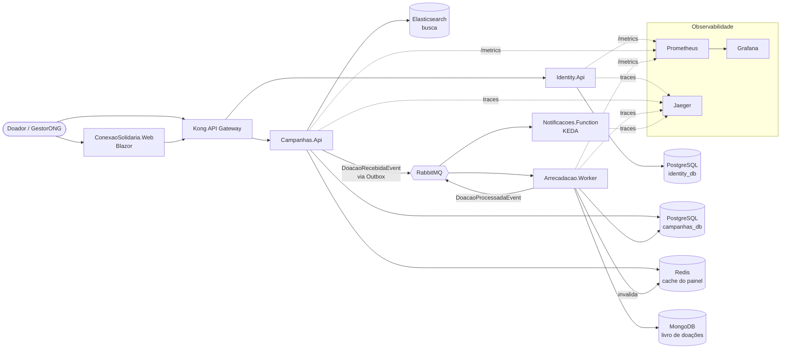

# Especificação — Conexão Solidária

Especificação do Hackathon da Fase 5 (PósTech FIAP — Arquitetura de Sistemas .NET), dos pré-requisitos até a conclusão.

| Item | Valor |
|---|---|
| Enunciado | Hackathon Fase 5 — "Conexão Solidária" (ONG Esperança Solidária) |
| Base de conhecimento | LLMWiki em `C:\Victor\Fiap\LLMWiki\wiki` (somente leitura) |
| Execução | Local (Minikube), com etapa de cloud **opcional** na Azure |
| CI/CD | GitHub Actions |
| Mensageria | RabbitMQ + MassTransit |
| Branch principal | `main` |

Referências da wiki usadas nesta spec aparecem como `wiki:<caminho>` (ex.: `wiki:fontes/tech-challenge/05-hackathon-fase-5-conexao-solidaria`).

---

## 1. Objetivo e escopo

Entregar um MVP de plataforma de doações com foco em **escalabilidade, observabilidade e automação**, aplicando o conteúdo das 5 fases do curso. A avaliação considera a **arquitetura**, não só o funcionamento.

**Obrigatório (enunciado):** RBAC com JWT, gestão de campanhas, cadastro de doador, painel de transparência, doação assíncrona via evento e Worker, ≥ 2 microsserviços, Kubernetes local com `.yaml`, `/health` e `/metrics`, dashboard Grafana com métricas reais, CI que faz build e gera imagem Docker a cada push na `main`.

**Bônus do enunciado (incluídos):** testes de unidade no CI e API Gateway.

**Fora do escopo:** pagamento real, envio real de e-mail, deploy de produção permanente na cloud.

---

## 2. Decisões de arquitetura (resumo dos ADRs)

Cada decisão vira um ADR em `docs/adr/NNNN-titulo.md` na Etapa 2.

| # | Decisão | Motivo |
|---|---|---|
| 1 | .NET 10 (LTS) em todos os projetos | Versão LTS vigente; o .NET 8 sai de suporte em nov/2026 |
| 2 | Monorepo com uma solução `.slnx` | Um repositório público para avaliar; projetos isolados por serviço |
| 3 | 3 bounded contexts: **Identidade**, **Campanhas/Arrecadação**, **Notificações** | Fronteiras por capacidade de negócio (DDD) |
| 4 | `Arrecadacao.Worker` pertence ao contexto Campanhas e é o **único escritor** de `TotalArrecadado` | O enunciado exige que o Worker atualize o total. Mesmo contexto, deploy separado para escalar sozinho |
| 5 | Doação retorna **202 Accepted** e publica `DoacaoRecebidaEvent` via **Transactional Outbox** | A API não atualiza o total. O Outbox evita perder o evento |
| 6 | Consumidores **idempotentes** (tabela `DoacoesProcessadas` com PK `DoacaoId`) | Entrega *at-least-once* do RabbitMQ |
| 7 | Persistência poliglota: PostgreSQL, MongoDB, Redis, Elasticsearch | Cada banco atende um padrão de acesso (seção 4.5) |
| 8 | JWT **RS256**: Identity assina com chave privada; demais serviços validam com a pública | Só o Identity pode emitir tokens |
| 9 | Kong (DB-less, Ingress Controller) como API Gateway | Conteúdo da Fase 3; configuração declarativa versionada |
| 10 | Notificações como função serverless (Azure Functions isolated) escalada por **KEDA** a partir da fila (escala a zero) | Serverless orientado a evento rodando no Kubernetes local |
| 11 | Observabilidade: prometheus-net (`/metrics`), OpenTelemetry (traces → Jaeger), Serilog (JSON no stdout), kube-prometheus-stack (Prometheus, Grafana, Alertmanager) | Métricas, logs e traces correlacionados por `traceId` |
| 12 | Evitar bibliotecas que passaram a ter licença comercial: MediatR, AutoMapper, FluentAssertions, MassTransit v9 | Usar MassTransit **8.x** (Apache 2.0), mapeamento manual, asserções do xUnit/Shouldly |

---

## 3. Requisitos funcionais

### RF01 — Autenticação e autorização (RBAC)
- Login por e-mail e senha retorna JWT com a claim `role` = `GestorONG` ou `Doador`.
- Endpoints de gestão exigem a policy `GestorONG`. Doação exige `Doador`.
- Um usuário `GestorONG` inicial é criado no startup a partir de variáveis de ambiente (Secret), nunca no código.

### RF02 — Gestão de campanhas (GestorONG)
- Campos: `Titulo`, `Descricao`, `DataInicio`, `DataFim`, `MetaFinanceira` (decimal 18,2), `Status` (`Ativa`, `Concluida`, `Cancelada`).
- Regras: `DataFim` não pode estar no passado; `MetaFinanceira > 0`; `DataFim >= DataInicio`.
- Transições: `Ativa → Concluida` e `Ativa → Cancelada`. Não há volta.

### RF03 — Cadastro de doador (público)
- Nome completo, e-mail **único** (normalizado em minúsculas), CPF com dígitos verificadores válidos, senha com hash **BCrypt** (work factor ≥ 12).
- Senha: mínimo de 8 caracteres, com letras, números e caractere especial.
- Aceite da política de privacidade obrigatório (data e versão registradas).

### RF04 — Painel de transparência (público)
- Lista **apenas campanhas Ativas** com título, meta e total arrecadado (calculado pelas doações processadas).
- Total eventualmente consistente: a UI informa "atualizado em até alguns segundos".

### RF05 — Doação (Doador autenticado)
- Envia `IdCampanha` e `ValorDoacao` (> 0).
- Regra: não é possível doar para campanha `Concluida`, `Cancelada` ou com `DataFim` vencida.
- A API valida, grava o evento no Outbox e responde **202** com `doacaoId`.

### RF06 — Busca de campanhas (Fase 4)
- `GET /api/v1/campanhas/busca?q=` com **fuzzy search** e ordenação por relevância (Elasticsearch).

### RF07 — Recibo de doação (Fase 3)
- Ao processar a doação, a função `Notificacoes.Function` registra um "recibo" simulado em log estruturado, com dados pessoais mascarados.

### RF08 — Direitos do titular (Fase 5, LGPD)
- `GET /api/v1/doadores/me` (acesso aos próprios dados) e `DELETE /api/v1/doadores/me` (anonimização: as doações permanecem para prestação de contas, sem dados pessoais).

### Critérios de aceitação (Gherkin)

Cada RF recebe um arquivo `.feature` em `tests/*.Bdd/Features/`. Exemplo obrigatório:

```gherkin
Funcionalidade: Doação para campanha
  Cenário: Doar para campanha ativa
    Dado uma campanha "Natal Solidário" com status "Ativa" e meta de 10000.00
    E um doador autenticado
    Quando ele doa 150.00 para a campanha
    Então a doação é aceita com status 202
    E o evento "DoacaoRecebidaEvent" é publicado

  Cenário: Doar para campanha cancelada
    Dado uma campanha "Inverno 2026" com status "Cancelada"
    E um doador autenticado
    Quando ele doa 50.00 para a campanha
    Então a doação é recusada com status 422
    E nenhum evento é publicado
```

---

## 4. Arquitetura

### 4.1 Diagrama



O diagrama final também é exportado em PNG para `docs/arquitetura/arquitetura.png` (entregável).

### 4.2 Componentes

| Componente | Tipo | Responsabilidade |
|---|---|---|
| `Identity.Api` | Microsserviço (Minimal API) | Cadastro de doador, login, emissão de JWT, direitos do titular |
| `Campanhas.Api` | Microsserviço (Minimal API) | CRUD de campanhas, painel, busca, recebimento de doações |
| `Arrecadacao.Worker` | Microsserviço (Worker Service) | Consome `DoacaoRecebidaEvent`, atualiza o total, grava o livro de doações |
| `Notificacoes.Function` | Função serverless | Consome `DoacaoProcessadaEvent` e emite o recibo simulado |
| `ConexaoSolidaria.Web` | Frontend Blazor Web App | Painel, busca, cadastro, login, doação e gestão |
| `BuildingBlocks.Contracts` | Biblioteca | Contratos dos eventos (versionados) |
| `BuildingBlocks.ServiceDefaults` | Biblioteca | Serilog, OpenTelemetry, health checks, ProblemDetails, autenticação JWT |

Cada serviço segue camadas DDD: `*.Domain` (sem dependências externas), `*.Application` (casos de uso), `*.Infrastructure` (EF Core, Dapper, MassTransit, clientes) e `*.Api`/`*.Worker` (entrada).

### 4.3 Endpoints

Todos sob `/api/v1`, documentados com OpenAPI e Swagger UI. Erros no formato `ProblemDetails` (RFC 9457).

| Serviço | Método e rota | Acesso | Sucesso | Erros principais |
|---|---|---|---|---|
| Identity | `POST /doadores` | Público | 201 + `Location` | 400 formato, 409 e-mail duplicado |
| Identity | `POST /auth/login` | Público | 200 `{accessToken, expiresIn}` | 401 |
| Identity | `GET /doadores/me` | Doador | 200 | 401 |
| Identity | `DELETE /doadores/me` | Doador | 204 | 401 |
| Campanhas | `POST /campanhas` | GestorONG | 201 + `Location` | 400, 401, 403, 422 regra |
| Campanhas | `GET /campanhas?page=&pageSize=` | GestorONG | 200 paginado | 401, 403 |
| Campanhas | `GET /campanhas/{id}` | GestorONG | 200 | 404 |
| Campanhas | `PUT /campanhas/{id}` | GestorONG | 204 | 404, 409 concorrência, 422 |
| Campanhas | `PATCH /campanhas/{id}/status` | GestorONG | 204 | 404, 422 transição inválida |
| Campanhas | `GET /transparencia/campanhas` | Público | 200 (cache Redis) | — |
| Campanhas | `GET /campanhas/busca?q=` | Público | 200 | 400 |
| Campanhas | `POST /doacoes` | Doador | 202 `{doacaoId}` | 400, 401, 403, 404, 422 campanha não ativa |

Endpoints técnicos em todos os serviços: `/health/live`, `/health/ready` (verifica banco, broker e cache) e `/metrics`.

### 4.4 Eventos (contratos v1)

| Evento | Publicado por | Consumido por | Campos |
|---|---|---|---|
| `DoacaoRecebidaEvent` | Campanhas.Api (Outbox) | Arrecadacao.Worker | `DoacaoId` (Guid v7), `CampanhaId`, `DoadorId`, `Valor`, `OcorridoEm` |
| `DoacaoProcessadaEvent` | Arrecadacao.Worker | Notificacoes.Function | `DoacaoId`, `CampanhaId`, `DoadorId`, `Valor`, `TotalArrecadado`, `ProcessadaEm` |
| `CampanhaAlteradaEvent` | Campanhas.Api (Outbox) | Campanhas.Api (indexador) | `CampanhaId`, `Titulo`, `Descricao`, `Status`, `MetaFinanceira` |

Regras: nomes no passado; sem dados pessoais (só IDs); retry com backoff exponencial; mensagens que falham vão para a fila `_error` (DLQ) do MassTransit; `traceparent` propagado nos headers.

### 4.5 Bancos de dados (base do PDF de justificativa)

| Banco | Dono | Dados | Justificativa |
|---|---|---|---|
| PostgreSQL 17 (`identity_db`) | Identity | Doadores, gestores | ACID, e-mail único por constraint, relacional simples |
| PostgreSQL 17 (`campanhas_db`) | Campanhas | Campanhas, total arrecadado, `DoacoesProcessadas`, Outbox | Valores financeiros pedem ACID; o `UPDATE` atômico do total e o registro de idempotência ficam na mesma transação |
| MongoDB 8 | Arrecadacao.Worker | Livro de doações (append-only, audit log) | Alto volume de escrita, documento flexível, histórico imutável (event sourcing "ou equivalente" da Fase 3) |
| Redis 8 | Campanhas | Cache do painel (cache-aside, TTL 30 s) | Painel público é a rota mais lida; o Worker invalida a chave após cada doação |
| Elasticsearch 9 | Campanhas | Índice `campanhas` | Busca fuzzy e relevância, impossíveis de forma eficiente no relacional |

---

## 5. Convenção de commits e regra de build

### 5.1 Formato

```text
<gitmoji> <tipo>(<escopo opcional>): <descrição no imperativo, minúscula, até 72 caracteres>

<corpo opcional: o porquê da mudança>

<rodapé opcional: BREAKING CHANGE, Refs #issue, Co-Authored-By>
```

| Gitmoji | Tipo | Uso |
|---|---|---|
| 🎉 | `chore` | Início de projeto ou solução |
| ✨ | `feat` | Nova funcionalidade |
| 🐛 | `fix` | Correção de bug |
| 📝 | `docs` | Documentação |
| ✅ | `test` | Testes |
| ♻️ | `refactor` | Refatoração sem mudar comportamento |
| ⚡️ | `perf` | Desempenho |
| 🎨 | `style` | Formatação |
| 🔧 | `chore` | Configuração |
| 🙈 | `chore` | `.gitignore` |
| ➕ / ➖ | `build` | Adicionar / remover dependência |
| 🏗️ | `refactor` | Mudança arquitetural |
| 🧱 | `build` | Infraestrutura (Docker, Kubernetes, Kong) |
| 👷 | `ci` | Pipeline de CI |
| 💚 | `ci` | Corrigir CI quebrado |
| 🗃️ | `feat` | Banco de dados e migrations |
| 🛂 | `feat` | Autenticação e autorização |
| 🔒️ | `fix` | Segurança e privacidade |
| 🦺 | `feat` | Validações |
| 🔊 | `feat` | Logs |
| 📈 | `feat` | Métricas e monitoramento |
| 🩺 | `feat` | Health checks |
| 🥅 | `feat` | Tratamento de erros |
| 🔖 | `chore` | Release / tag de versão |
| 💥 | `feat!` | Breaking change |

Exemplos: `✨ feat(campanhas): adiciona criação de campanha`, `🗃️ feat(campanhas): adiciona migration inicial`, `👷 ci: gera imagem docker no push da main`.

### 5.2 Granularidade

- Um commit por arquivo criado sempre que o arquivo compila sozinho.
- Quando arquivos dependem uns dos outros (ex.: `.csproj` + `Program.cs`, interface + implementação + registro no DI), o commit contém o **menor conjunto que compila e passa nos testes**.
- Nunca misturar mudanças não relacionadas no mesmo commit.

### 5.3 Todo commit compila sem erro

Validado em três camadas:

1. **Hooks locais (Husky.Net)**, instalados na Etapa 3:
   - `pre-commit`: `dotnet build -c Release -warnaserror` e `dotnet format --verify-no-changes`.
   - `commit-msg`: valida o formato da seção 5.1 com a regex `^(\S+) (feat|fix|docs|style|refactor|perf|test|build|ci|chore|revert)(\([a-z0-9-]+\))?!?: .{1,72}$`.
   - `pre-push`: `dotnet test`.
2. **Antes de abrir PR**, verificar cada commit da branch:
   ```bash
   git rebase --exec "dotnet build -c Release -warnaserror && dotnet test --no-build -c Release" main
   ```
3. **CI** roda build e testes em todo push e PR. A `main` é protegida: merge só com CI verde.

Commits que só alteram documentação passam pelos mesmos hooks.

---

## 6. Boas práticas obrigatórias

### 6.1 Código e arquitetura
- [ ] `Directory.Build.props`: `Nullable` habilitado, `TreatWarningsAsErrors`, `AnalysisLevel=latest-recommended`, `ImplicitUsings`.
- [ ] `Directory.Packages.props` (Central Package Management) com versões fixas e `packages.lock.json` (`RestorePackagesWithLockFile`).
- [ ] `global.json` fixando o SDK; `.editorconfig` com regras de estilo; `.gitattributes` normalizando finais de linha.
- [ ] SOLID: SRP por caso de uso; DIP (domínio define interfaces, infraestrutura implementa); ISP (repositórios de leitura e escrita separados); `TimeProvider` injetado para regras com data.
- [ ] DDD: agregados pequenos, value objects (`Email`, `Cpf`, `Dinheiro`, `Periodo`), invariantes na raiz, referência entre agregados por ID, modelo rico (sem anêmico).
- [ ] DTOs `record` separados para entrada e saída; nunca expor entidades.
- [ ] Injeção por construtor; `ValidateScopes` e `ValidateOnBuild` em desenvolvimento.
- [ ] `CancellationToken` em toda operação de I/O.

### 6.2 API
- [ ] Rotas no plural, versionadas (`/api/v1`), status HTTP corretos, `201` com `Location`, paginação com `pageSize` máximo de 100.
- [ ] Middleware global de exceções → `ProblemDetails`; erros de domínio → 422.
- [ ] Validação de entrada com FluentValidation; invariantes no domínio.
- [ ] Logs estruturados (Serilog, JSON) com `traceId`, sem dados pessoais, senhas ou tokens.
- [ ] OpenAPI + Swagger UI com esquema de segurança Bearer.
- [ ] Rate limiting no gateway; CORS restrito ao frontend.
- [ ] Resiliência nas chamadas HTTP (`Microsoft.Extensions.Http.Resilience`: timeout, retry, circuit breaker).

### 6.3 Dados
- [ ] EF Core Code First, Fluent API em `IEntityTypeConfiguration<T>`, precisão decimal explícita, migrations versionadas.
- [ ] Concorrência otimista na `Campanha` (`xmin` do PostgreSQL).
- [ ] Leituras com `AsNoTracking` e projeção; painel com Dapper (consulta parametrizada).
- [ ] Um `DbContext` por bounded context; `DbContext` Scoped; `IDbContextFactory` no Worker.
- [ ] MongoDB: índice único em `doacaoId`. Redis: chaves com namespace e versão (`transparencia:v1:campanhas-ativas`). Elasticsearch: analyzer `brazilian` + `asciifolding`, `fuzziness: AUTO`, `prefix_length: 1`, filtro de status em `filter`.

### 6.4 Mensageria
- [ ] Transactional Outbox (MassTransit + EF Core) na Campanhas.Api.
- [ ] Consumidor idempotente; filas e mensagens duráveis; DLQ; retry com backoff.
- [ ] Contratos versionados no projeto `BuildingBlocks.Contracts`.

### 6.5 Containers e Kubernetes
- [ ] Dockerfile multi-stage (SDK → runtime `aspnet`), usuário não root (`USER app`), `.dockerignore`, `HEALTHCHECK`, tag fixa (nunca `latest`).
- [ ] Manifestos com Kustomize (`deploy/k8s/base` + `overlays/local` e `overlays/azure`).
- [ ] `Deployment` (nunca Pod avulso) com `replicas ≥ 2` nas APIs, `requests`/`limits`, probes `liveness`/`readiness`/`startup`, `securityContext` (`runAsNonRoot`, `readOnlyRootFilesystem`, `drop: [ALL]`), estratégia `RollingUpdate`.
- [ ] `ConfigMap` só para configuração não sensível; `Secret` gerado por script a partir do `.env` (nunca versionado; só `*.example.yaml`).
- [ ] Labels `app.kubernetes.io/*`; namespaces `conexao`, `infra`, `observability`, `kong`, `keda`.
- [ ] HPA na `Campanhas.Api` e no `Arrecadacao.Worker`; PVC para bancos.

### 6.6 CI/CD (GitHub Actions)
- [ ] `permissions` mínimas; actions de terceiros fixadas por SHA; `concurrency`; `timeout-minutes`; cache do NuGet.
- [ ] Dependabot para NuGet, GitHub Actions e Docker.
- [ ] Scan de segredos (gitleaks) e de vulnerabilidades da imagem (Trivy, falha em `CRITICAL`).
- [ ] Imagens com tag `sha-<commit>` e `vX.Y.Z` em releases; push no GHCR só em push na `main`.

### 6.7 Segurança e LGPD
- [ ] Senha com BCrypt; CPF criptografado em repouso (ASP.NET Core Data Protection) e mascarado em respostas e logs (`***.456.789-**`).
- [ ] Minimização: eventos e logs só com IDs.
- [ ] Base legal documentada por finalidade (`docs/lgpd/registro-de-tratamento.md`), aceite da política com versão e data, canal do encarregado no README.
- [ ] Direitos do titular: acesso e anonimização (RF08).
- [ ] Zero credenciais no código, YAML ou imagem; HTTPS no gateway.
- [ ] Checklist OWASP Top 10 revisado na Etapa 16.

### 6.8 Observabilidade
- [ ] `/metrics` com métricas HTTP (`UseHttpMetrics`) e de negócio (`doacoes_recebidas_total`, `doacoes_processadas_total`, `doacoes_valor_total`), labels de baixa cardinalidade.
- [ ] Traces OpenTelemetry com propagação W3C em HTTP e RabbitMQ.
- [ ] Dashboard Grafana como código (JSON versionado e provisionado por ConfigMap).
- [ ] Alertas: taxa de 5xx > 5% em 5 min, fila `_error` com mensagens, pod reiniciando.

---

## 7. Cobertura das 5 fases

| Fase | Disciplina | Onde é aplicada |
|---|---|---|
| 1 | Desenvolvimento de APIs .NET | Minimal APIs, middlewares, DI, Serilog, JWT, Dapper no painel, Swagger, cache Redis, resiliência. Bônus: GraphQL (consulta do painel com HotChocolate) |
| 1 | DDD | Event Storming, Domain Storytelling, linguagem ubíqua, bounded contexts, context map, agregados e value objects |
| 1 | EF Core | Code First, Fluent API, migrations, concorrência otimista, projeções |
| 1 | Princípios e Qualidade de Software | Pirâmide de testes, xUnit, TDD no agregado `Campanha`, BDD com Reqnroll na doação, integração com Testcontainers, carga com k6, cobertura |
| 2 | Microsserviços | 4 serviços, banco por serviço, comunicação assíncrona, Outbox, idempotência, circuit breaker |
| 2 | Docker | Multi-stage, não root, `docker-compose` com healthchecks |
| 2 | Kubernetes / Orquestração | Deployments, Services, ConfigMaps, Secrets, probes, HPA, PVC; AKS na etapa opcional |
| 2 | Mensageria | RabbitMQ, MassTransit, exchanges, DLQ, retry, garantias de entrega |
| 3 | Serverless | `Notificacoes.Function` (Azure Functions isolated) com escala a zero via KEDA |
| 3 | API Gateway | Kong DB-less: rotas, rate limiting, CORS, correlation-id, plugin Prometheus |
| 3 | Monitoramento | Prometheus, Grafana, Alertmanager. Opcional: Zabbix monitorando `/health/ready` |
| 3 | Monitoramento avançado | OpenTelemetry + Jaeger (traces), golden metrics, logs estruturados, SLO do painel |
| 3 | Event sourcing / audit log | Livro de doações append-only no MongoDB |
| 4 | GitHub Actions | CI (build, testes, cobertura, imagem, scans) e CD opcional |
| 4 | NoSQL | MongoDB (livro de doações) e Redis (cache) |
| 4 | Elasticsearch | Busca fuzzy com relevância e sincronização por evento |
| 4 | Azure | Etapa opcional: AKS, ACR, Key Vault, Workload Identity |
| 4 | AWS / Azure DevOps | Não adotados: alternativas descartadas em favor de Azure e GitHub Actions (ADR) |
| 5 | Metodologias ágeis | Scrum (sprints, cerimônias), Kanban no GitHub Projects com WIP, XP (TDD, pareamento, CI), DoR/DoD, histórias INVEST |
| 5 | SOLID | Seção 6.1, revisada em todo PR |
| 5 | LGPD | Seção 6.7, RF08, registro de tratamento |
| 5 | Blazor e Razor | `ConexaoSolidaria.Web` |
| 5 | IA em .NET (intro da fase) | Bônus: assistente de descrição de campanha com Semantic Kernel + modelo local (Ollama), com revisão humana e sem dados pessoais |

---

## 8. Skills e MCP do Claude Code

| Etapa | Ferramenta | Uso |
|---|---|---|
| 3 | Skill `/init` | Gerar o `CLAUDE.md` com a estrutura, comandos e a regra de commits (incluir o caminho da LLMWiki como referência somente leitura) |
| 3 em diante | Skill `/fewer-permission-prompts` | Liberar comandos de leitura recorrentes (`dotnet`, `kubectl get`) |
| Todas | MCP `claude-vscode` (`getDiagnostics`) | Conferir erros e avisos de compilação antes de cada commit |
| 4–8 | MCP Microsoft Learn | Consultar a documentação atual de .NET 10, ASP.NET Core, EF Core e Azure Functions |
| 8–9 | MCP Playwright | Testes de UI do Blazor e verificação visual |
| Todas | `gh` CLI ou MCP GitHub | Issues, GitHub Projects, PRs e acompanhamento do CI |
| Fim de cada etapa | Skill `/code-review` | Revisão do diff antes do PR |
| 4, 5, 16 | Skill `/security-review` | Autenticação, LGPD e revisão final |
| Após cada etapa | Skill `/simplify` | Remover duplicação e complexidade |
| 11–13 | Skill `/run` | Subir a aplicação e validar o fluxo de ponta a ponta |
| 14 | Skill `/loop` | Acompanhar a execução do CI |
| 17 | Skill `pdf` | Gerar o PDF de justificativa dos bancos e o relatório de entrega |

MCPs são adicionados com `claude mcp add` ou pelo comando `/mcp`.

---

## 9. Plano de execução

Cada etapa termina com: critérios de pronto atendidos, `/code-review`, PR com CI verde e merge na `main`. Sprints de 1 semana, ajustadas à data de entrega.

### Etapa 0 — Pré-requisitos

**Hardware:** 16 GB de RAM (mínimo; o cluster local usa ~10 GB), 4+ núcleos, 40 GB livres em disco.

**Software (Windows 11):**

| Ferramenta | Instalação | Verificação |
|---|---|---|
| Git | `winget install Git.Git` | `git --version` |
| .NET SDK 10 | `winget install Microsoft.DotNet.SDK.10` | `dotnet --list-sdks` |
| Docker Desktop (WSL 2) | `winget install Docker.DockerDesktop` | `docker version` |
| Minikube | `winget install Kubernetes.minikube` | `minikube version` |
| kubectl | `winget install Kubernetes.kubectl` | `kubectl version --client` |
| Helm 3 | `winget install Helm.Helm` | `helm version` |
| k6 | `winget install k6 --source winget` | `k6 version` |
| Azure Functions Core Tools v4 | `winget install Microsoft.Azure.FunctionsCoreTools` | `func --version` |
| GitHub CLI | `winget install GitHub.cli` | `gh auth status` |
| Azure CLI (só cloud opcional) | `winget install Microsoft.AzureCLI` | `az version` |
| VS Code + C# Dev Kit, ou Visual Studio 2026 | — | — |
| Postman | `winget install Postman.Postman` | — |
| OBS Studio (gravação) | `winget install OBSProject.OBSStudio` | — |
| Claude Code | — | `claude --version` |

**Contas:** GitHub (repositório público e GHCR), Discord do grupo, Miro (Event Storming), Azure (só para a etapa opcional, com alerta de orçamento).

**Leitura prévia na wiki:** `wiki:fontes/tech-challenge/05-hackathon-fase-5-conexao-solidaria`, `wiki:disciplinas/tech-challenge` e as páginas `wiki:boas-praticas/*`.

**Pronto quando:** todos os comandos de verificação respondem sem erro.

### Etapa 1 — Fundação do repositório *(concluída)*

- `git init`, branch `main`, `.gitignore`, `README.md`, `docs/SPEC.md`, `docs/ROTEIRO-VIDEO.md`.
- Pendente: criar o repositório **público** no GitHub (`gh repo create`) e fazer o push.

### Etapa 2 — Planejamento ágil e DDD

1. GitHub Projects com colunas `Backlog → Pronto (DoR) → Em andamento (WIP 3) → Revisão → Concluído`.
2. Histórias de usuário (INVEST) para RF01–RF08, com critérios em Gherkin, como issues.
3. Definition of Ready e Definition of Done em `docs/agil/`.
4. Event Storming (Miro) dos fluxos "criar campanha" e "doar"; exportar imagens para `docs/ddd/`.
5. Domain Storytelling do fluxo de doação; glossário da linguagem ubíqua; context map.
6. ADRs da seção 2 em `docs/adr/`.

Commits: `📝 docs(ddd): ...`, `📝 docs(adr): ...`, `📝 docs(agil): ...`.
Wiki: `wiki:disciplinas/ddd`, `wiki:disciplinas/metodologias-ageis`.

### Etapa 3 — Esqueleto da solução e qualidade automática

1. `global.json`, `.editorconfig`, `.gitattributes`, `Directory.Build.props`, `Directory.Packages.props`.
2. `ConexaoSolidaria.slnx` e os projetos vazios de `src/` e `tests/` (estrutura da seção 4.2).
3. Husky.Net (`dotnet new tool-manifest`, `dotnet tool install Husky`) com os hooks da seção 5.3.
4. CI mínimo (`.github/workflows/ci.yml`): restore, format, build, test.
5. `CLAUDE.md` com a skill `/init`.

Commits: `🎉 chore: cria solução ConexaoSolidaria`, `🔧 chore: adiciona Directory.Build.props`, `👷 ci: adiciona build e testes`, etc.
Pronto quando: `dotnet build -warnaserror` e `dotnet test` passam localmente e no CI.

### Etapa 4 — Identity.Api

1. Domínio com TDD: `Email`, `Cpf` (validação de dígitos), `Senha` (política), `Usuario` com `Role`.
2. Infraestrutura: EF Core + PostgreSQL, migration inicial, índice único no e-mail, CPF criptografado.
3. Casos de uso: cadastrar doador, login (BCrypt + JWT RS256), consultar e anonimizar o próprio cadastro.
4. Seed do `GestorONG` por variáveis de ambiente.
5. ServiceDefaults: Serilog, OpenTelemetry, health checks, ProblemDetails, `/metrics`.
6. Testes de unidade e de integração (WebApplicationFactory + Testcontainers).

Ferramentas: `/security-review` ao final.
Wiki: `wiki:disciplinas/api-dotnet`, `wiki:disciplinas/efcore`, `wiki:conceitos/jwt`.

### Etapa 5 — Campanhas.Api

1. Agregado `Campanha` com TDD (todas as regras do RF02 e RF05), `TimeProvider` injetado.
2. EF Core + migrations, concorrência `xmin`.
3. CRUD com policy `GestorONG`.
4. Painel com Dapper + Redis (cache-aside, TTL 30 s).
5. `POST /doacoes`: valida a campanha, grava no Outbox, responde 202.
6. Indexação no Elasticsearch por `CampanhaAlteradaEvent` e endpoint de busca fuzzy.
7. Testes de unidade, integração e o `.feature` de doação (Reqnroll).

Wiki: `wiki:disciplinas/elasticsearch`, `wiki:disciplinas/nosql`, `wiki:conceitos/cache-distribuido`.

### Etapa 6 — Arrecadacao.Worker e mensageria

1. Consumer MassTransit de `DoacaoRecebidaEvent`.
2. Transação única no `campanhas_db`: insere `DoacoesProcessadas(DoacaoId)` e faz `UPDATE ... SET total_arrecadado = total_arrecadado + @valor`. Se o `DoacaoId` já existir, ignora (idempotência).
3. Grava o lançamento no MongoDB (upsert por `doacaoId`), invalida o cache do painel e publica `DoacaoProcessadaEvent`.
4. Retry, DLQ, métricas de negócio, health checks e `/metrics` (Kestrel na porta 9090).
5. Testes: unidade do handler e integração com Testcontainers (RabbitMQ, PostgreSQL, MongoDB), incluindo mensagem duplicada.

Wiki: `wiki:disciplinas/mensageria`, `wiki:conceitos/idempotencia`, `wiki:conceitos/garantias-de-entrega`.

### Etapa 7 — Notificacoes.Function (serverless)

1. Azure Functions isolated worker (.NET 10; se o runtime ainda não suportar, .NET 8 isolated) com gatilho RabbitMQ.
2. Recibo simulado em log estruturado, com dados mascarados.
3. Imagem Docker e `ScaledObject` do KEDA (fila como gatilho, `minReplicaCount: 0`).

Wiki: `wiki:disciplinas/serverless-apps`, `wiki:conceitos/azure-functions`.

### Etapa 8 — Frontend Blazor (+ IA opcional)

1. Blazor Web App: SSR estático para painel e busca; `InteractiveServer` para formulários.
2. Páginas: início, transparência, busca, cadastro, login, doar, gestão de campanhas (`<AuthorizeView Roles="GestorONG">`).
3. Autenticação por cookie no servidor do Blazor; o JWT fica no servidor e é anexado por `DelegatingHandler` às chamadas ao Kong.
4. Testes de componentes com bUnit; E2E com Playwright (bônus).
5. Bônus IA: botão "Sugerir descrição" com Semantic Kernel + Ollama; a sugestão é editável e nunca publicada sem revisão.

Wiki: `wiki:disciplinas/blazor-razor`, `wiki:conceitos/etica-e-explicabilidade-em-ia`.

### Etapa 9 — Testes complementares

1. Cenários BDD de todos os RFs.
2. Teste de carga k6 no painel e na doação, com thresholds (`p(95)<500ms`, erros < 1%), em `tests/load/`.
3. Relatório de cobertura (coverlet + ReportGenerator). Meta indicativa: ≥ 80% nos projetos `*.Domain` e `*.Application`.

Wiki: `wiki:disciplinas/qualidade-software`, `wiki:disciplinas/principios-qualidade`.

### Etapa 10 — Containers e docker-compose

1. Um Dockerfile multi-stage por serviço, `.dockerignore` na raiz.
2. `deploy/docker-compose.yml` com toda a stack, healthchecks e `depends_on: condition: service_healthy`; variáveis em `.env` (modelo em `.env.example`).
3. Pronto quando: `docker compose up -d` sobe tudo e o fluxo de doação funciona de ponta a ponta.

Wiki: `wiki:disciplinas/docker`.

### Etapa 11 — Kubernetes local

1. `minikube start --cpus=6 --memory=12g --addons=metrics-server` (o metrics-server é exigido pelo HPA).
2. Imagens no cluster: `minikube image load` (ou pull do GHCR).
3. `deploy/k8s/base`: namespaces, infra (StatefulSets com PVC para PostgreSQL, MongoDB, RabbitMQ e Elasticsearch com heap de 512 MB; Deployment do Redis), apps (Deployments, Services, ConfigMaps, HPA).
4. `scripts/k8s-secrets.ps1` cria os Secrets a partir do `.env`.
5. `kubectl apply -k deploy/k8s/overlays/local` e `kubectl get pods -A` com tudo `Running`.

Wiki: `wiki:disciplinas/kubernetes`, `wiki:conceitos/minikube`.

### Etapa 12 — API Gateway (Kong)

1. Kong Ingress Controller via Helm, modo DB-less.
2. `Ingress` por serviço e `KongPlugin`: `rate-limiting`, `cors`, `correlation-id`, `prometheus`.
3. Admin API sem exposição externa.

Wiki: `wiki:disciplinas/api-gateway`, `wiki:conceitos/kong-gateway`.

### Etapa 13 — Observabilidade

1. `kube-prometheus-stack` via Helm no namespace `observability`; `ServiceMonitor` para cada serviço, RabbitMQ (porta 15692) e Kong.
2. Jaeger all-in-one; exporter OTLP configurado nos serviços.
3. Dashboard "Conexão Solidária" (JSON em `deploy/observability/dashboards/`): requisições/s, latência p95, taxa de 5xx, CPU e memória dos pods, doações processadas, mensagens na fila.
4. Regras de alerta da seção 6.8.
5. Opcional: Zabbix (via `docker compose --profile zabbix`) monitorando `/health/ready`.

Wiki: `wiki:disciplinas/monitoramento-acesso`, `wiki:disciplinas/monitoramento-acesso-avancado`.

### Etapa 14 — CI/CD (GitHub Actions)

1. `ci.yml` (push e PR na `main`): jobs `build-test` (format, build, testes, cobertura no `GITHUB_STEP_SUMMARY` e artefato) → `secret-scan` (gitleaks) → `docker` (matriz por serviço, build com cache, Trivy, push no GHCR apenas em push na `main`).
2. `dependabot.yml`.
3. Proteção da `main`: PR obrigatório e CI verde.
4. Opcional `cd.yml`: deploy no AKS com OIDC e `kubectl rollout status` (Rolling Update).

Wiki: `wiki:disciplinas/github-actions`.

### Etapa 15 — Cloud opcional (Azure)

1. Alerta de orçamento antes de criar qualquer recurso.
2. Bicep em `deploy/azure/`: grupo de recursos, ACR, AKS (Workload Identity), Key Vault (CSI Secrets Store).
3. Overlay `deploy/k8s/overlays/azure` e `cd.yml`.
4. **Excluir o grupo de recursos após a gravação** (`az group delete`).

Wiki: `wiki:disciplinas/orquestracao-k8s`, `wiki:disciplinas/azure-devops`.

### Etapa 16 — Revisão de segurança e LGPD

1. `/security-review` em toda a base.
2. Checklists das seções 6.7 e OWASP Top 10.
3. `docs/lgpd/registro-de-tratamento.md` e política de privacidade.

Wiki: `wiki:disciplinas/lgpd`, `wiki:conceitos/owasp-top-10`.

### Etapa 17 — Documentação e entregáveis

1. README final: pré-requisitos, `docker compose`, Kubernetes passo a passo, URLs, usuários de teste, variáveis de ambiente.
2. Diagrama de arquitetura (Mermaid + PNG).
3. `docs/justificativa-bancos.md` → PDF (skill `pdf`) a partir da seção 4.5.
4. Coleção Postman em `docs/postman/`.
5. Relatório de entrega (PDF): grupo, participantes, usernames do Discord, links do repositório, do vídeo e da documentação.

### Etapa 18 — Vídeo

Seguir `docs/ROTEIRO-VIDEO.md`. Duração máxima: 15 minutos.

### Etapa 19 — Conclusão

1. Checklist da seção 10 completo.
2. Tag `v1.0.0` (`🔖 chore: versão 1.0.0`) e GitHub Release.
3. Confirmar que o repositório está público e o README funciona numa máquina limpa.
4. Excluir recursos de cloud, se criados.
5. Entregar o relatório na plataforma da FIAP.

---

## 10. Checklist final de entrega

- [ ] RF01–RF08 funcionando e cobertos por testes.
- [ ] ≥ 2 microsserviços (entregues: 4).
- [ ] Doação publica `DoacaoRecebidaEvent`; o Worker atualiza o total; a API **não** atualiza o total.
- [ ] Manifestos `.yaml` (Deployments, Services, ConfigMaps) no repositório.
- [ ] `/health` e `/metrics` em todos os serviços.
- [ ] Dashboard Grafana com métricas reais.
- [ ] CI em push na `main` fazendo build e gerando imagem Docker.
- [ ] Bônus: testes no CI e API Gateway.
- [ ] Repositório público com README passo a passo.
- [ ] Diagrama de arquitetura e PDF de justificativa dos bancos.
- [ ] Vídeo de até 15 minutos.
- [ ] Relatório com grupo, Discord e links.
- [ ] Todos os commits no formato da seção 5 e compilando.
- [ ] Nenhum segredo no histórico do git (gitleaks verde).

## 11. Riscos

| Risco | Mitigação |
|---|---|
| Memória insuficiente no Minikube | Heap do Elasticsearch em 512 MB, réplicas mínimas no overlay local, Zabbix opcional |
| Runtime do Azure Functions sem .NET 10 | Usar .NET 8 isolated só na função |
| Licença comercial em versões novas de bibliotecas | Fixar MassTransit 8.x; evitar MediatR, AutoMapper, FluentAssertions |
| Custo na Azure | Cloud opcional, alerta de orçamento, exclusão após a gravação |
| Total exibido desatualizado por alguns segundos | Consistência eventual explicada na UI e no vídeo |
| Vídeo acima de 15 minutos | Roteiro cronometrado e ensaio prévio |
