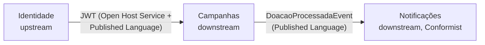

# Mapa de contextos

[← README](../../README.md) · [Modelo de domínio](../../specs/product/dominio.md)

Fronteiras entre os modelos do sistema e a forma como eles conversam. Os bounded contexts são `Identidade`, `Campanhas` e `Notificações`.

## Diagrama

## Contextos

| Contexto | Componentes | Dono dos dados | Subdomínio |
|---|---|---|---|
| Identidade | `Identity.Api` | `identity_db` | Genérico |
| Campanhas | `Campanhas.Api`, `Arrecadacao.Worker` | `campanhas_db`, MongoDB, Redis, Elasticsearch | Principal (arrecadação) e suporte (transparência) |
| Notificações | `Notificacoes.Function` | Nenhum (sem estado próprio) | Genérico |

## Relações

| Relação | Padrão | Detalhe |
|---|---|---|
| Identidade → Campanhas | Open Host Service + Published Language | O JWT é o contrato publicado; Campanhas lê só `sub` e `role` |
| Campanhas → Notificações | Published Language; Notificações é Conformist | Notificações aceita o contrato do evento como está |

## Regras de fronteira

1. Não há chamadas síncronas entre serviços: Campanhas não consulta Identidade em tempo de execução.
2. Contextos não referenciam o código um do outro; a comunicação é só por JWT e por eventos de `ConexaoSolidaria.Contracts` (verificado por teste de arquitetura).
3. Cada contexto tem o seu banco, com usuário de banco próprio.
4. Eventos de domínio ficam dentro do contexto; só eventos de integração versionados cruzam fronteiras.

Decisões relacionadas: [ADR 0003](../adr/0003-bounded-contexts-e-componentes.md), [ADR 0004](../adr/0004-worker-unico-escritor-do-total.md) e [ADR 0008](../adr/0008-jwt-rs256-emitido-pela-identity.md).
