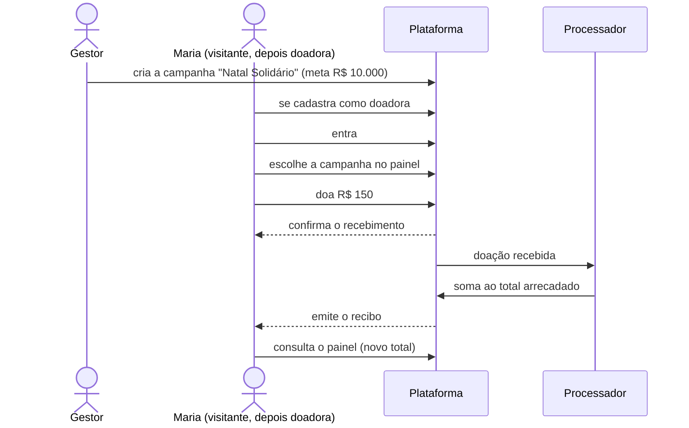

# Domain Storytelling — "Maria doa para o Natal Solidário"

[← README](../../README.md) · [Modelo de domínio](../../specs/product/dominio.md)

História contada na linguagem do negócio ([glossário](../glossary.md)). Atores: **gestor**, **visitante/doadora** e os sistemas **plataforma** e **processador**.

> Versão textual. O desenho pictográfico do Miro pode ser exportado como PNG para esta pasta (`domain-storytelling-doacao.png`) como complemento.

## História

| Passo | Quem | Faz | O quê | Para quem / com o quê |
|---|---|---|---|---|
| 1 | Gestor | cria | a campanha "Natal Solidário" | com meta de R$ 10.000 |
| 2 | Visitante (Maria) | se cadastra | como doadora | na plataforma |
| 3 | Maria | entra | com e-mail e senha | na plataforma |
| 4 | Maria | escolhe | a campanha | no painel de transparência |
| 5 | Maria | doa | R$ 150 | à campanha |
| 6 | Plataforma | confirma | o recebimento | a Maria |
| 7 | Processador | soma | a doação | ao total arrecadado |
| 8 | Plataforma | emite | o recibo | a Maria |
| 9 | Qualquer visitante | vê | o novo total | no painel |

## Sequência

## Termos usados

Campanha, doador, doação recebida, doação processada, total arrecadado, painel de transparência e recibo; definições no [glossário](../glossary.md).
