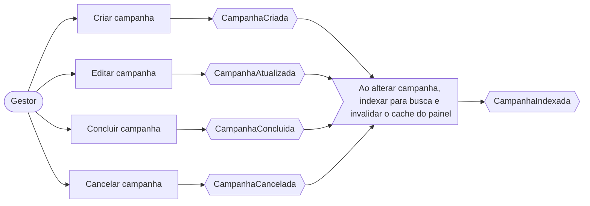

# Event Storming — fluxo "Criar e manter campanha"

[← README](../../README.md) · [Modelo de domínio](../../specs/product/dominio.md)

Resultado do Event Storming do fluxo de campanha, em formato de texto. Legenda das cores do quadro: **laranja** = evento, **azul** = comando, **amarelo** = ator, **lilás** = política, **rosa** = sistema externo.

> Versão textual. O quadro do Miro pode ser exportado como PNG para esta pasta (`event-storming-campanha.png`) como complemento.

## Linha do tempo

## Tabela

| Ordem | Ator | Comando | Agregado | Evento | Política seguinte |
|---|---|---|---|---|---|
| 1 | Gestor | Criar campanha | `Campanha` | `CampanhaCriada` | Ao alterar campanha, indexar e invalidar o cache do painel |
| 2 | Gestor | Editar campanha | `Campanha` | `CampanhaAtualizada` | Idem |
| 3 | Gestor | Concluir campanha | `Campanha` | `CampanhaConcluida` | Idem |
| 4 | Gestor | Cancelar campanha | `Campanha` | `CampanhaCancelada` | Idem |
| 5 | Consumidor de indexação | Indexar campanha | — | `CampanhaIndexada` | — |

## Regras descobertas

| Regra | Onde está especificada |
|---|---|
| Data fim não pode ser anterior a hoje nem à data início | [Feature 002](../../specs/features/002-gestao-campanhas/spec.md) |
| Meta financeira maior que zero | [Feature 002](../../specs/features/002-gestao-campanhas/spec.md) |
| Só campanha ativa é editável; transições só a partir de `Ativa` | [Feature 002](../../specs/features/002-gestao-campanhas/data-model.md) |
| Só campanha ativa e dentro do período aparece no painel e recebe doação | [Feature 004](../../specs/features/004-painel-transparencia/spec.md) e [005](../../specs/features/005-doacao/spec.md) |
| Cancelada ou concluída sai da busca | [Feature 006](../../specs/features/006-busca-campanhas/spec.md) |
