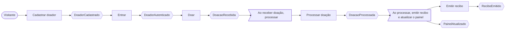

# Event Storming — fluxo "Doar"

[← README](../../README.md) · [Modelo de domínio](../../specs/product/dominio.md)

Resultado do Event Storming do fluxo de doação, em formato de texto. Legenda das cores do quadro: **laranja** = evento, **azul** = comando, **amarelo** = ator, **lilás** = política, **rosa** = sistema externo.

> Versão textual. O quadro do Miro pode ser exportado como PNG para esta pasta (`event-storming-doacao.png`) como complemento.

## Linha do tempo

## Tabela

| Ordem | Ator | Comando | Agregado | Evento | Política seguinte |
|---|---|---|---|---|---|
| 1 | Visitante | Cadastrar doador | `Usuario` | `DoadorCadastrado` | — |
| 2 | Doador | Entrar | `Usuario` | `DoadorAutenticado` | — |
| 3 | Doador | Doar | `Campanha` (validação de campanha apta) | `DoacaoRecebida` | Ao receber doação, processar |
| 4 | Worker | Processar doação | `Campanha` | `DoacaoProcessada` | Ao processar, emitir recibo e atualizar o painel |
| 5 | Função | Emitir recibo | — | `ReciboEmitido` | — |

## Pontos quentes (dúvidas levantadas e decisões)

| Ponto | Decisão | Onde está registrado |
|---|---|---|
| Quem atualiza o total arrecadado? | Só o Worker, depois de processar | [ADR 0004](../adr/0004-worker-unico-escritor-do-total.md) |
| E se a mensagem chegar duas vezes? | Consumidor idempotente por `doacaoId` | [ADR 0006](../adr/0006-consumidores-idempotentes.md) |
| E se o broker cair depois de aceitar a doação? | Transactional Outbox | [ADR 0005](../adr/0005-doacao-assincrona-com-outbox.md) |
| O recibo precisa de dados do doador? | Não; usa só IDs e valor | [Feature 007](../../specs/features/007-recibo-doacao/spec.md) |

Especificação das funcionalidades envolvidas: [001](../../specs/features/001-autenticacao/spec.md), [003](../../specs/features/003-cadastro-doador/spec.md), [005](../../specs/features/005-doacao/spec.md) e [007](../../specs/features/007-recibo-doacao/spec.md).
