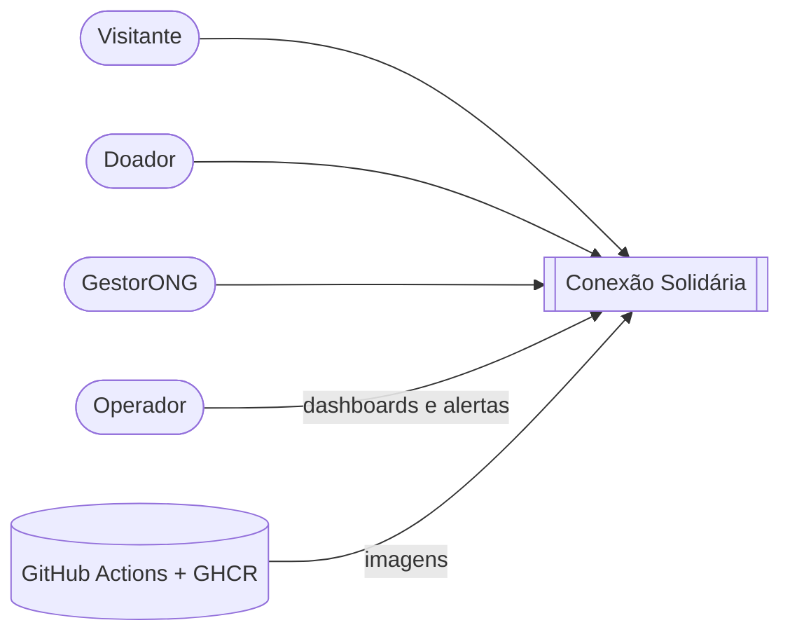
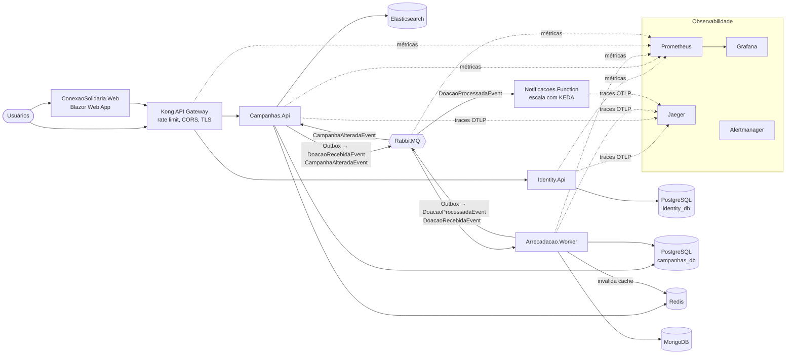
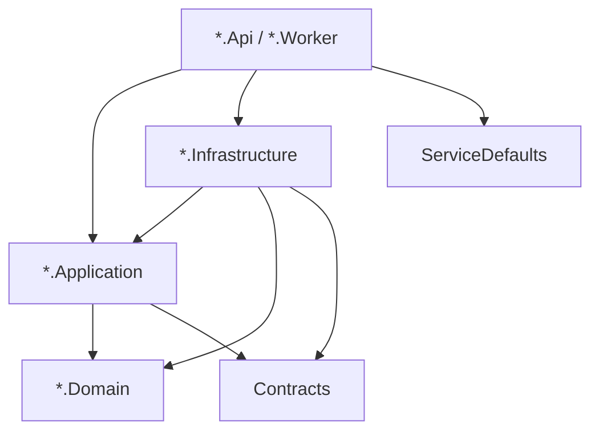

# 07 — Arquitetura

[← README](../../README.md) · Anterior: [06 — Modelo de domínio](../../specs/product/dominio.md) · Próximo: [08 — Decisões arquiteturais](08-decisoes-arquiteturais.md)

## 7.1 Visão de contexto



## 7.2 Visão de containers



O PNG exportado deste diagrama (`docs/arquitetura/arquitetura.png`) é entregável do Hackathon.

## 7.3 Componentes

| Componente | Tecnologia | Responsabilidade | Expõe | Depende de |
|---|---|---|---|---|
| `Identity.Api` | ASP.NET Core Minimal API | Cadastro, login, JWT, direitos do titular | HTTP 8080 | PostgreSQL |
| `Campanhas.Api` | ASP.NET Core Minimal API | Campanhas, painel, busca, recebimento de doações, indexação | HTTP 8080 | PostgreSQL, Redis, Elasticsearch, RabbitMQ |
| `Arrecadacao.Worker` | Worker Service + MassTransit | Processa doações, livro de doações | HTTP 9090 (`/metrics`, health) | PostgreSQL, MongoDB, Redis, RabbitMQ |
| `Notificacoes.Function` | Azure Functions isolated worker | Recibo de doação | — | RabbitMQ |
| `ConexaoSolidaria.Web` | Blazor Web App | Interface | HTTP 8080 | Kong |
| Kong | Kong Ingress Controller (DB-less) | Entrada única da API | HTTPS 443 | APIs |

## 7.4 Fluxo da doação (sequência)

```mermaid
sequenceDiagram
  autonumber
  actor D as Doador
  participant K as Kong
  participant C as Campanhas.Api
  participant PG as PostgreSQL (campanhas_db)
  participant MQ as RabbitMQ
  participant W as Arrecadacao.Worker
  participant MG as MongoDB
  participant R as Redis
  participant F as Notificacoes.Function

  D->>K: POST /api/v1/doacoes (JWT)
  K->>C: encaminha (rate limit, correlation-id)
  C->>C: valida JWT (role Doador) e entrada
  C->>PG: lê campanha e verifica se está apta
  C->>PG: grava OutboxMessage (DoacaoRecebidaEvent) na transação
  C-->>D: 202 Accepted {doacaoId}
  PG-->>MQ: entrega do Outbox (background)
  MQ->>W: DoacaoRecebidaEvent
  W->>PG: BEGIN; INSERT doacoes_processadas; UPDATE total; Outbox(DoacaoProcessadaEvent); COMMIT
  W->>MG: upsert lançamento no livro de doações
  W->>R: remove cache do painel
  PG-->>MQ: entrega do Outbox do Worker
  MQ->>F: DoacaoProcessadaEvent
  F->>F: registra ReciboEmitido
  D->>K: GET /api/v1/transparencia/campanhas
  K->>C: encaminha
  C->>R: cache vazio
  C->>PG: consulta (Dapper)
  C-->>D: total atualizado
```

**Pontos de consistência:**
- O passo 5 é atômico: ou a doação foi aceita e o evento será publicado, ou nada aconteceu.
- O passo 8 é atômico: idempotência, total e próximo evento na mesma transação.
- O passo 9 (MongoDB) fica fora da transação. Se falhar, a mensagem é reentregue: o passo 8 detecta a duplicata e não soma de novo, mas o Worker **sempre** executa os passos 9 e 10, que são idempotentes (upsert por `doacaoId` e remoção de chave). Assim o livro de doações fica completo mesmo após falhas.
- O passo 10 é "melhor esforço": se falhar, o cache expira sozinho em 30 s.

## 7.5 Fluxo da campanha (indexação)

1. Gestor cria ou altera a campanha (`Campanhas.Api`).
2. Na mesma transação: grava a campanha e o `CampanhaAlteradaEvent` no Outbox.
3. O consumidor `IndexarCampanhaConsumer` (na própria `Campanhas.Api`) faz upsert no índice `campanhas` do Elasticsearch.
4. Falha no Elasticsearch: retry com backoff; depois, DLQ. Reindexação completa disponível por endpoint administrativo `POST /admin/reindexar` (`GestorONG`).

## 7.6 Estrutura de pastas

```text
.
├── .config/dotnet-tools.json
├── .github/
│   ├── workflows/ci.yml, cd.yml, codeql.yml
│   └── dependabot.yml
├── .husky/                          # hooks de git (Husky.Net)
├── deploy/
│   ├── docker-compose.yml
│   ├── .env.example
│   ├── helm/                        # values dos charts (kong, keda, kube-prometheus-stack, jaeger)
│   ├── rabbitmq/definitions.json    # filas e bindings da função
│   ├── k8s/
│   │   ├── base/                    # namespaces, infra, apps, kong, keda
│   │   └── overlays/{local,azure}/
│   ├── observability/
│   │   ├── dashboards/conexao-solidaria.json
│   │   └── alerts/prometheus-rules.yaml
│   └── azure/main.bicep             # cloud opcional
├── docs/
│   ├── ROTEIRO-VIDEO.md, spec/
│   ├── adr/, agil/, ddd/, arquitetura/, lgpd/, postman/
│   └── justificativa-bancos.md (+ PDF)
├── scripts/                         # verificar-pre-requisitos.ps1, k8s-secrets.ps1, up.ps1
├── src/
│   ├── BuildingBlocks/
│   │   ├── ConexaoSolidaria.Contracts/
│   │   └── ConexaoSolidaria.ServiceDefaults/
│   ├── Services/
│   │   ├── Identity/{Identity.Domain, Identity.Application, Identity.Infrastructure, Identity.Api}
│   │   └── Campanhas/{Campanhas.Domain, Campanhas.Application, Campanhas.Infrastructure, Campanhas.Api, Arrecadacao.Worker}
│   ├── Functions/Notificacoes.Function/
│   └── Web/ConexaoSolidaria.Web/
├── tests/
│   ├── Identity.UnitTests/, Identity.IntegrationTests/
│   ├── Campanhas.UnitTests/, Campanhas.IntegrationTests/
│   ├── Arrecadacao.Worker.Tests/
│   ├── ConexaoSolidaria.Bdd/
│   ├── ConexaoSolidaria.Web.Tests/  # bUnit
│   └── load/                        # scripts k6
├── ConexaoSolidaria.slnx
├── Directory.Build.props, Directory.Packages.props, global.json
├── .editorconfig, .gitattributes, .dockerignore, .gitignore
└── README.md
```

## 7.7 Camadas e dependências



| Projeto | Pode referenciar | Não pode referenciar |
|---|---|---|
| `*.Domain` | Nada além do BCL | EF Core, ASP.NET, MassTransit, qualquer pacote de infraestrutura |
| `*.Application` | Domain, Contracts | Infrastructure, ASP.NET |
| `*.Infrastructure` | Application, Domain, Contracts, pacotes de infra | Api |
| `*.Api` / `*.Worker` | Todos acima + ServiceDefaults | Outro bounded context |

A regra é verificada por um teste de arquitetura (NetArchTest) em cada `*.UnitTests`.

## 7.8 Visão de implantação (Kubernetes local)

| Namespace | Conteúdo |
|---|---|
| `conexao` | identity-api, campanhas-api, arrecadacao-worker, notificacoes-function, web, jobs de migration |
| `infra` | postgres, mongodb, redis, rabbitmq, elasticsearch |
| `kong` | Kong Ingress Controller e gateway |
| `observability` | Prometheus, Grafana, Alertmanager, Jaeger |
| `keda` | Operador KEDA |

Detalhes de recursos, probes e manifestos: [13 — Infraestrutura](13-infraestrutura.md).

## 7.9 Configuração

Toda configuração vem de variáveis de ambiente (seção `__` do .NET, ex.: `ConnectionStrings__Campanhas`).

| Variável | Serviço | Origem no K8s |
|---|---|---|
| `ConnectionStrings__Identity` | Identity.Api | Secret |
| `ConnectionStrings__Campanhas` | Campanhas.Api, Worker | Secret |
| `ConnectionStrings__Redis` | Campanhas.Api, Worker | Secret |
| `ConnectionStrings__Mongo` | Worker | Secret |
| `RabbitMq__Host`, `RabbitMq__Usuario`, `RabbitMq__Senha` | Campanhas.Api, Worker, Function | ConfigMap (host) e Secret (credenciais) |
| `Elasticsearch__Url`, `Elasticsearch__ApiKey` | Campanhas.Api | ConfigMap e Secret |
| `Jwt__Issuer`, `Jwt__Audience` | Identity.Api, Campanhas.Api | ConfigMap |
| `Jwt__ChavePrivadaPem` | Identity.Api | Secret |
| `Jwt__ChavePublicaPem` | Campanhas.Api | ConfigMap (chave pública não é segredo) |
| `Cpf__ChaveCifra`, `Cpf__ChaveHash` | Identity.Api | Secret |
| `Seed__GestorEmail`, `Seed__GestorSenha` | Identity.Api | Secret |
| `OTEL_EXPORTER_OTLP_ENDPOINT`, `OTEL_SERVICE_NAME` | Todos | ConfigMap |
| `ASPNETCORE_ENVIRONMENT` | Todos | ConfigMap |
