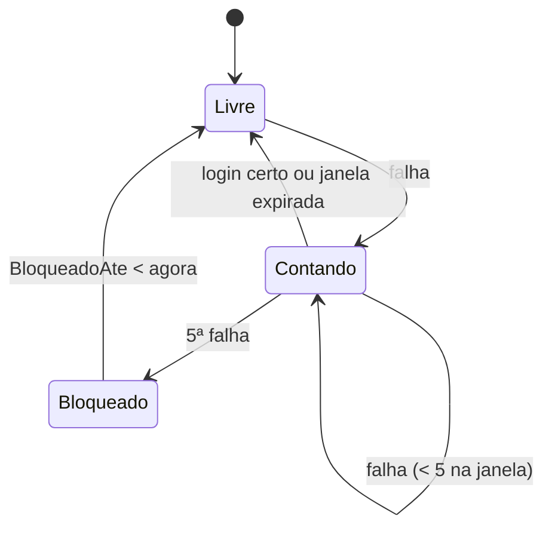

# Modelo de dados — Feature 001 (Autenticação)

[← Spec](spec.md)

## Agregado `Usuario` (contexto Identidade)

Campos usados nesta feature. O agregado completo está em [domínio](../../product/dominio.md).

| Membro | Tipo | Regra |
|---|---|---|
| `Id` | `UsuarioId` (GUID v7) | Vai no `sub` do token |
| `Email` | `Email` (VO) | Normalizado em minúsculas; único |
| `SenhaHash` | `string` | BCrypt; `null` após anonimizar |
| `Role` | `Role` | `GestorONG` ou `Doador` |
| `AnonimizadoEm` | `DateTimeOffset?` | Preenchido → login recusado |

| Método | Regra |
|---|---|
| `CriarGestor(email, senhaHash, agora)` | Só usado pelo seed; role `GestorONG`, sem CPF e sem consentimento |
| `VerificarSenha(senha, hasher)` | Falso se anonimizado ou sem hash |

## Entidade `TentativaLogin`

| Campo | Tipo | Regra |
|---|---|---|
| `EmailHash` | `byte[]` | PK; HMAC-SHA256 do e-mail normalizado |
| `Falhas` | `int` | Zera após login certo ou fim do bloqueio |
| `JanelaInicio` | `DateTimeOffset` | Início da janela de 15 min |
| `BloqueadoAte` | `DateTimeOffset?` | Preenchido na 5ª falha: agora + 15 min |

### Transições

## Tabelas (`identity_db`)

| Tabela | Colunas usadas | Definição completa |
|---|---|---|
| `usuarios` | `id`, `email`, `senha_hash`, `role`, `anonimizado_em` | [dados](../../product/dados.md) |
| `tentativas_login` | `email_hash` (PK), `falhas`, `janela_inicio`, `bloqueado_ate` | [dados](../../product/dados.md) |

## Token (modelo de leitura)

| Claim | Exemplo | Origem |
|---|---|---|
| `sub` | `0192f3a1-7c2e-7b4a-9f1e-2b3c4d5e6f70` | `Usuario.Id` |
| `role` | `Doador` | `Usuario.Role` |
| `jti` | GUID novo | Gerado |
| `iat`, `exp` | Unix time; `exp = iat + 3600` | `TimeProvider` |
| `iss`, `aud` | `conexao-identity`, `conexao-api` | `Jwt__Issuer`, `Jwt__Audience` |
