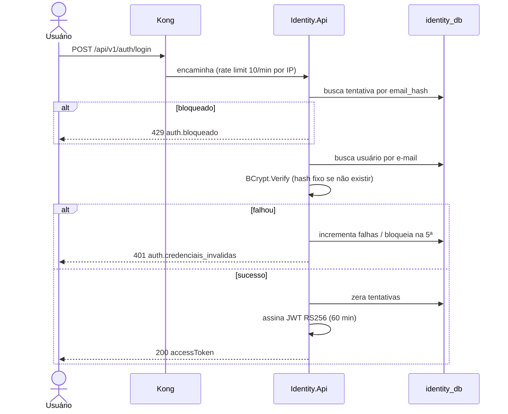

# Plano técnico — Feature 001 (Autenticação)

[← Spec](spec.md) · [Pesquisa](research.md) · [Modelo de dados](data-model.md) · [Contrato](contracts/api.md) · [Tarefas](tasks.md)

## Resumo

Login por e-mail e senha na `Identity.Api`, emitindo JWT RS256. A validação do token e as policies ficam no `ConexaoSolidaria.ServiceDefaults`, usado por todos os serviços. O bloqueio por tentativas usa a tabela `tentativas_login`.

## Contexto técnico

| Item | Valor |
|---|---|
| Linguagem | C# / .NET 10 |
| Dependências | `Microsoft.AspNetCore.Authentication.JwtBearer`, `BCrypt.Net-Next`, `Npgsql.EntityFrameworkCore.PostgreSQL`, `FluentValidation` |
| Armazenamento | PostgreSQL `identity_db` |
| Testes | xUnit v3, Shouldly, NSubstitute, Testcontainers (PostgreSQL), Reqnroll |
| Metas | Login p95 < 400 ms (BCrypt incluso); bloqueio exato na 6ª tentativa |
| Restrições | Sem dado pessoal no token e nos logs; chave privada só na Identity |

## Verificação da constituição

| Princípio | Atendido | Como |
|---|---|---|
| I. Spec antes do código | ✅ | Spec com cenários Gherkin e esclarecimentos |
| II. Domínio no centro | ✅ | `Usuario`, `Email` e `TentativaLogin` sem dependência de infraestrutura |
| III. Testes primeiro | ✅ | TDD em `Email`, `Usuario.VerificarSenha` e `TentativaLogin` |
| IV. Cobertura ≥ 90% | ✅ | Unidade + integração dos endpoints e do seed |
| V. `<summary>` | ✅ | Em todos os tipos e membros |
| VI. Commits | ✅ | Um commit por tarefa (ver [tarefas](tasks.md)) |
| VII. Segurança | ✅ | RS256, BCrypt, mensagem genérica, tempo constante, `FallbackPolicy` |
| VIII. Eventos | N/A | Feature não publica eventos |
| IX. Observabilidade | ✅ | Métrica `logins_total{resultado}`; log sem e-mail |
| X. Infra como código | ✅ | Chaves via Secret/ConfigMap |
| XI. Simplicidade | ✅ | Sem ASP.NET Identity nem provedor externo |
| XII. Português | ✅ | Linguagem ubíqua |

## Estrutura de código

```text
src/BuildingBlocks/ConexaoSolidaria.ServiceDefaults/
└── Autenticacao/ExtensoesAutenticacao.cs        # AddAutenticacaoJwt(), policies e FallbackPolicy
src/Services/Identity/
├── Identity.Domain/
│   ├── Usuarios/{Usuario.cs, UsuarioId.cs, Role.cs, Email.cs}
│   └── Autenticacao/TentativaLogin.cs
├── Identity.Application/
│   ├── Abstracoes/{IUsuarioRepositorio.cs, IHasherSenha.cs, IEmissorToken.cs, ITentativaLoginRepositorio.cs}
│   └── Autenticacao/{Autenticar.cs, LoginRequest.cs, TokenResponse.cs, LoginRequestValidator.cs}
├── Identity.Infrastructure/
│   ├── Persistencia/{IdentityDbContext.cs, Configuracoes/*, Migrations/*}
│   ├── Seguranca/{HasherSenhaBcrypt.cs, EmissorJwtRs256.cs}
│   └── Seed/SeedGestorHostedService.cs
└── Identity.Api/Endpoints/AutenticacaoEndpoints.cs
tests/unit/Identity.UnitTests/…
tests/integration/Identity.IntegrationTests/AutenticacaoTests.cs
tests/e2e/ConexaoSolidaria.Bdd/Features/001-autenticacao.feature
```

## Design



## Segurança

- Chave privada em `Jwt__ChavePrivadaPem` (Secret, só Identity); pública em `Jwt__ChavePublicaPem` (ConfigMap).
- `FallbackPolicy = RequireAuthenticatedUser()`; `AllowAnonymous()` só no login, cadastro, painel e busca.
- Rotação de chave: [runbook](../../../docs/runbooks/rotacao-chave-jwt.md).

## Observabilidade

| Sinal | Definição |
|---|---|
| Métrica | `logins_total{resultado="sucesso|falha|bloqueado"}` |
| Log | `Information` "Login realizado para {UsuarioId}"; `Warning` "Login bloqueado" sem e-mail (só `email_hash` truncado) |
| Trace | Span `Autenticar` |

## Riscos

| Risco | Mitigação |
|---|---|
| Diferença de relógio entre pods | `ClockSkew` de 30 s |
| Chave pública desatualizada após rotação | Runbook com ordem de atualização (pública antes da privada) |
