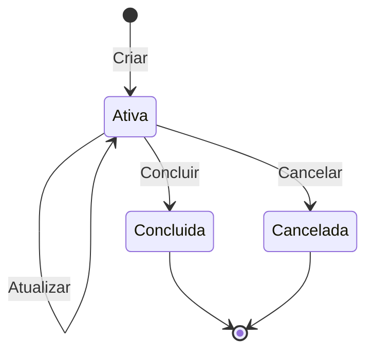

# Modelo de dados — Feature 002 (Gestão de campanhas)

[← Spec](spec.md)

## Agregado `Campanha` (contexto Campanhas)

| Membro | Tipo | Regra |
|---|---|---|
| `Id` | `CampanhaId` (GUID v7) | Identidade |
| `Titulo` | `string` | 3–120 caracteres, sem espaços nas pontas |
| `Descricao` | `string` | Até 2000 caracteres |
| `Periodo` | `Periodo` (VO) | `DataInicio ≤ DataFim` |
| `MetaFinanceira` | `Dinheiro` (VO) | > 0 e ≤ 99.999.999,99 |
| `TotalArrecadado` | `Dinheiro` (VO) | ≥ 0; só o Worker altera ([005](../005-doacao/data-model.md)) |
| `Status` | `StatusCampanha` | `Ativa`, `Concluida`, `Cancelada` |
| `Versao` | `uint` | `xmin` do PostgreSQL |

| Método | Pré-condição | Erro |
|---|---|---|
| `Criar(titulo, descricao, periodo, meta, hoje)` | `periodo.DataFim ≥ hoje`; `meta > 0` | `campanha.data_fim_passada`, `campanha.meta_invalida` |
| `Atualizar(titulo, descricao, periodo, meta, hoje)` | Status `Ativa` + regras da criação | `campanha.nao_editavel` |
| `Concluir()` | Status `Ativa` | `campanha.transicao_invalida` |
| `Cancelar()` | Status `Ativa` | `campanha.transicao_invalida` |

## Value objects

| VO | Regra | Erro |
|---|---|---|
| `Periodo` | `DataInicio` e `DataFim` (`DateOnly`); fim ≥ início | `campanha.periodo_invalido` |
| `Dinheiro` | `decimal`, 2 casas (arredondamento bancário), não negativo | `dinheiro.negativo` |

## Estados

## Eventos de domínio

| Evento | Quando | Vira evento de integração |
|---|---|---|
| `CampanhaCriada` | `Criar` | `CampanhaAlteradaEvent` |
| `CampanhaAtualizada` | `Atualizar` | `CampanhaAlteradaEvent` |
| `CampanhaConcluida` | `Concluir` | `CampanhaAlteradaEvent` |
| `CampanhaCancelada` | `Cancelar` | `CampanhaAlteradaEvent` |

## Tabela `campanhas` (`campanhas_db`)

| Coluna | Tipo | Restrições |
|---|---|---|
| `id` | `uuid` | PK |
| `titulo` | `varchar(120)` | NOT NULL |
| `descricao` | `varchar(2000)` | NOT NULL |
| `data_inicio` | `date` | NOT NULL |
| `data_fim` | `date` | NOT NULL, CHECK (`data_fim >= data_inicio`) |
| `meta_financeira` | `numeric(18,2)` | NOT NULL, CHECK (`> 0`) |
| `total_arrecadado` | `numeric(18,2)` | NOT NULL, DEFAULT 0, CHECK (`>= 0`) |
| `status` | `varchar(20)` | NOT NULL, CHECK (`Ativa`, `Concluida`, `Cancelada`) |
| `criado_em`, `atualizado_em` | `timestamptz` | NOT NULL |
| `xmin` | sistema | Token de concorrência |

Índice `ix_campanhas_status_data_fim (status, data_fim)`. Tabelas do Outbox do MassTransit (`outbox_message`, `outbox_state`, `inbox_state`) entram na mesma migration. Visão completa: [dados](../../product/dados.md).
