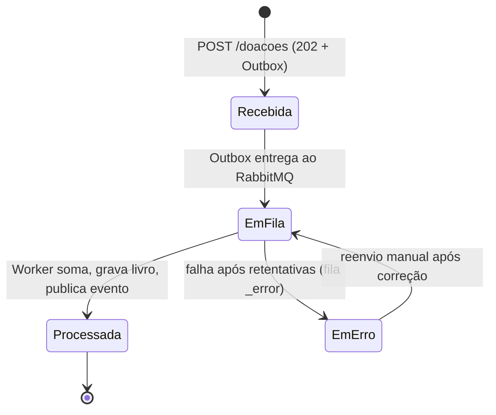

# Modelo de dados — Feature 005 (Doação)

[← Spec](spec.md)

## Regras no agregado `Campanha`

| Método | Regra | Erro |
|---|---|---|
| `PodeReceberDoacao(hoje)` | `Status == Ativa` e `DataInicio ≤ hoje ≤ DataFim` | — |
| `RegistrarDoacaoProcessada(valor)` | `valor > 0`; soma ao total mesmo se encerrada depois do aceite | `doacao.valor_invalido` |

O Worker reproduz `RegistrarDoacaoProcessada` com `UPDATE` atômico ([pesquisa R3](research.md)).

## Tabelas (`campanhas_db`)

### `doacoes_processadas` (idempotência do Worker)

| Coluna | Tipo | Restrições |
|---|---|---|
| `doacao_id` | `uuid` | PK |
| `campanha_id` | `uuid` | NOT NULL, FK → `campanhas.id` |
| `valor` | `numeric(18,2)` | NOT NULL, CHECK (`> 0`) |
| `processada_em` | `timestamptz` | NOT NULL |

### `chaves_idempotencia` (cabeçalho `Idempotency-Key`)

| Coluna | Tipo | Restrições |
|---|---|---|
| `chave` | `varchar(100)` | PK (com `doador_id`) |
| `doador_id` | `uuid` | PK (com `chave`) |
| `doacao_id` | `uuid` | NOT NULL |
| `hash_corpo` | `bytea` | NOT NULL (detecta repetição com corpo diferente) |
| `criada_em` | `timestamptz` | NOT NULL; registros > 24 h removidos |

### Operação do Worker (uma transação)

```sql
INSERT INTO doacoes_processadas (doacao_id, campanha_id, valor, processada_em)
VALUES (@DoacaoId, @CampanhaId, @Valor, @Agora);          -- PK duplicada => já processada

UPDATE campanhas
   SET total_arrecadado = total_arrecadado + @Valor, atualizado_em = @Agora
 WHERE id = @CampanhaId
RETURNING total_arrecadado;                                -- vai no DoacaoProcessadaEvent

-- + linha do Outbox com DoacaoProcessadaEvent (MassTransit)
```

## Livro de doações (MongoDB)

Banco `arrecadacao`, coleção `lancamentos_doacao`:

```json
{
  "_id": "0192f3c4-2b3c-7d4e-9f50-6a7b8c9d0e1f",
  "campanhaId": "0192f3b0-1a2b-7c3d-8e4f-5a6b7c8d9e0f",
  "doadorId": "0192f3a1-7c2e-7b4a-9f1e-2b3c4d5e6f70",
  "valor": { "$numberDecimal": "150.00" },
  "totalAposLancamento": { "$numberDecimal": "150.00" },
  "recebidaEm": { "$date": "2026-11-10T17:10:05Z" },
  "processadaEm": { "$date": "2026-11-10T17:10:06Z" },
  "traceId": "4bf92f3577b34da6a3ce929d0e0e4736",
  "versaoEsquema": 1
}
```

| Item | Definição |
|---|---|
| Chave | `_id = doacaoId` (idempotência natural) |
| Índice | `{ campanhaId: 1, processadaEm: -1 }` |
| Escrita | `ReplaceOne` com `IsUpsert = true` |
| Valores | `Decimal128` (nunca `double`) |

## Ciclo de vida da doação


