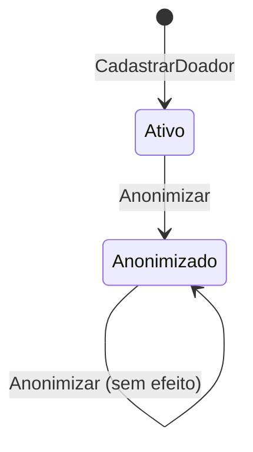

# Modelo de dados — Feature 008 (Direitos do titular)

[← Spec](spec.md)

## Método `Usuario.Anonimizar(agora)`

| Campo | Antes | Depois |
|---|---|---|
| `NomeCompleto` | `Maria Silva` | `Doador anonimizado` |
| `Email` | `maria@exemplo.com` | `anonimo+<id>@invalid` |
| `Cpf` (cifrado e hash) | Valores | `null` |
| `SenhaHash` | Hash BCrypt | `null` |
| `Consentimento` | Versão e data | Mantido (prova do aceite, sem dado pessoal) |
| `AnonimizadoEm` | `null` | `agora` |
| `Id`, `Role`, `CriadoEm` | — | Mantidos |

Regras:
- Idempotente: se `AnonimizadoEm` já estiver preenchido, não altera nada e retorna sucesso.
- Depois de anonimizado, `VerificarSenha` sempre retorna falso ([001](../001-autenticacao/data-model.md)).

## Estados do usuário

## Modelo de leitura `DoadorResponse`

| Campo | Origem |
|---|---|
| `id` | `usuarios.id` |
| `nomeCompleto` | `usuarios.nome_completo` |
| `email` | `usuarios.email` |
| `cpfMascarado` | `Cpf.Mascarado()` após decifrar |
| `criadoEm` | `usuarios.criado_em` |
| `consentimento.versao`, `consentimento.aceitoEm` | `usuarios.consentimento_versao`, `usuarios.consentimento_em` |

Dados de outros contextos (livro de doações, `doacoes_processadas`) não são alterados: guardam só o ID.
