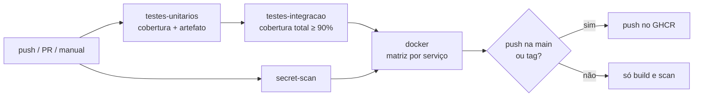

# CI/CD (GitHub Actions)

[← README](../../README.md)

Atende ao requisito avaliado do trabalho substitutivo — **pipeline que executa os testes unitários e retorna a cobertura** ([feature 009](../features/009-ci-testes-cobertura/spec.md)) — e aplica o conteúdo de CI/CD da Fase 4 (imagens Docker, varreduras, deploy opcional). Referências: `wiki:disciplinas/github-actions`, `wiki:boas-praticas/github-actions`, `wiki:conceitos/ci-cd`.

## Workflows

| Arquivo | Gatilho | Objetivo |
|---|---|---|
| `.github/workflows/ci.yml` | `push` e `pull_request` na `main`; tags `v*`; `workflow_dispatch` | Testes unitários com cobertura (avaliado), testes completos, scans, imagens Docker |
| `.github/workflows/codeql.yml` | `push`/`pull_request` na `main` e semanal | Análise estática de segurança (C#) |
| `.github/workflows/cd.yml` | `workflow_run` do CI concluído com sucesso na `main` + `workflow_dispatch` | **Opcional**: deploy no AKS |
| `.github/dependabot.yml` | Semanal | Atualizar NuGet, GitHub Actions e imagens Docker |

## Pipeline de CI



### Job `testes-unitarios` (requisito avaliado)
| Passo | Comando / action | Falha quando |
|---|---|---|
| Checkout | `actions/checkout` | — |
| SDK | `actions/setup-dotnet` com `global-json-file: global.json` e cache de NuGet por `packages.lock.json` | — |
| Ferramentas | `dotnet tool restore` | — |
| Restore | `dotnet restore --locked-mode` | Lock file desatualizado |
| Formato | `dotnet format --verify-no-changes --no-restore` | Código fora do `.editorconfig` |
| Build | `dotnet build -c Release --no-restore -warnaserror` | Erro ou aviso |
| Testes unitários | `dotnet test -c Release --no-build --filter Category=Unit --settings coverlet.runsettings --collect "XPlat Code Coverage" --logger trx --results-directory TestResults/unit` | Teste falhando |
| Relatório | `dotnet reportgenerator -reports:"TestResults/unit/**/coverage.cobertura.xml" -targetdir:coverage/unit -reporttypes:"Html;Cobertura;JsonSummary;MarkdownSummaryGithub" -title:"Cobertura — testes unitários"` | — |
| Cobertura no resumo | `cat coverage/unit/SummaryGithub.md >> $GITHUB_STEP_SUMMARY` | — |
| Artefatos (download) | `actions/upload-artifact` com `if: always()`: `cobertura-testes-unitarios` (`coverage/unit`) e `resultados-testes-unitarios` (`TestResults/unit/**/*.trx`), `retention-days: 14` | — |

### Job `testes-integracao`
Depende de `testes-unitarios`. Mesmos passos de preparação, mais:

| Passo | Comando / action | Falha quando |
|---|---|---|
| Pacotes vulneráveis | `dotnet list package --vulnerable --include-transitive` + verificação da saída | Vulnerabilidade alta ou crítica |
| Todos os testes | `dotnet test -c Release --no-build --settings coverlet.runsettings --collect "XPlat Code Coverage" --logger trx --results-directory TestResults/all` | Teste falhando (Testcontainers usa o Docker do runner) |
| Relatório | `dotnet reportgenerator -reports:"TestResults/all/**/coverage.cobertura.xml" -targetdir:coverage/all -reporttypes:"Html;JsonSummary;MarkdownSummaryGithub" -title:"Cobertura total"` | — |
| Cobertura mínima | `pwsh ./scripts/verificar-cobertura.ps1 -Minimo 90 -Relatorio coverage/all/Summary.json` | Linhas ou ramos abaixo de 90% no total ou em algum projeto de `src/` |
| Artefatos | `cobertura-total` e `resultados-testes`, `retention-days: 14` | — |

### Job `secret-scan`
`actions/checkout` com `fetch-depth: 0` + gitleaks. Falha se houver segredo em qualquer commit.

### Job `docker` (matriz)
| Item | Definição |
|---|---|
| Matriz | `identity-api`, `campanhas-api`, `arrecadacao-worker`, `notificacoes-function`, `web` (+ `migrator-identity`, `migrator-campanhas`) |
| Build | `docker/setup-buildx-action` + `docker/build-push-action` com `cache-from/to: type=gha` |
| Tags | `docker/metadata-action`: `sha-<7 caracteres>`; em tag git `vX.Y.Z`, também `X.Y.Z` e `X.Y` |
| Labels OCI | `org.opencontainers.image.source`, `revision`, `version` |
| Scan | Trivy na imagem carregada localmente (`severity: CRITICAL`, `ignore-unfixed: true`, `exit-code: 1`); SARIF enviado para a aba Security |
| Push | Só se `github.event_name == 'push'` (na `main` ou tag); em PR a imagem é construída e escaneada, mas não publicada |
| Registry | `ghcr.io/kulessa/trabalho/<servico>` (nome do GHCR sempre em minúsculas); login com `GITHUB_TOKEN`; pacotes herdam a visibilidade do repositório |

### Modelo de `ci.yml` (trecho)
```yaml
name: CI
on:
  push: { branches: [main], tags: ['v*'] }
  pull_request: { branches: [main] }
  workflow_dispatch:

permissions:
  contents: read

concurrency:
  group: ci-${{ github.ref }}
  cancel-in-progress: true

jobs:
  testes-unitarios:
    runs-on: ubuntu-latest
    timeout-minutes: 15
    steps:
      - uses: actions/checkout@<sha>        # v4
      - uses: actions/setup-dotnet@<sha>    # v4
        with:
          global-json-file: global.json
          cache: true
          cache-dependency-path: '**/packages.lock.json'
      - run: dotnet tool restore
      - run: dotnet restore --locked-mode
      - run: dotnet format --verify-no-changes --no-restore
      - run: dotnet build -c Release --no-restore -warnaserror
      - name: Testes unitários com cobertura
        run: >
          dotnet test -c Release --no-build --filter Category=Unit
          --settings coverlet.runsettings --collect "XPlat Code Coverage"
          --logger trx --results-directory TestResults/unit
      - name: Relatório de cobertura
        if: always()
        run: >
          dotnet reportgenerator -reports:"TestResults/unit/**/coverage.cobertura.xml"
          -targetdir:coverage/unit -reporttypes:"Html;Cobertura;JsonSummary;MarkdownSummaryGithub"
          -title:"Cobertura — testes unitários"
      - name: Cobertura no resumo da execução
        if: always()
        run: cat coverage/unit/SummaryGithub.md >> "$GITHUB_STEP_SUMMARY"
      - name: Publicar cobertura para download
        if: always()
        uses: actions/upload-artifact@<sha>   # v4
        with:
          name: cobertura-testes-unitarios
          path: coverage/unit
          retention-days: 14
      - name: Publicar resultados dos testes
        if: always()
        uses: actions/upload-artifact@<sha>   # v4
        with:
          name: resultados-testes-unitarios
          path: TestResults/unit/**/*.trx
          retention-days: 14

  testes-integracao:
    needs: testes-unitarios
    runs-on: ubuntu-latest
    timeout-minutes: 30
    steps:
      # checkout, setup-dotnet, restore e build como acima
      - run: dotnet test -c Release --no-build --settings coverlet.runsettings --collect "XPlat Code Coverage" --logger trx --results-directory TestResults/all
      - run: dotnet reportgenerator -reports:"TestResults/all/**/coverage.cobertura.xml" -targetdir:coverage/all -reporttypes:"Html;JsonSummary;MarkdownSummaryGithub" -title:"Cobertura total"
      - run: pwsh ./scripts/verificar-cobertura.ps1 -Minimo 90 -Relatorio coverage/all/Summary.json
      # ... upload de cobertura-total e resultados-testes (if: always())

  docker:
    needs: [testes-integracao, secret-scan]
    runs-on: ubuntu-latest
    timeout-minutes: 30
    permissions:
      contents: read
      packages: write
      security-events: write
    strategy:
      fail-fast: false
      matrix:
        servico: [identity-api, campanhas-api, arrecadacao-worker, notificacoes-function, web]
    steps:
      # checkout, buildx, login (só em push), metadata, build (load), trivy, push
```

`<sha>` = SHA completo do commit da versão da action (fixação por SHA, com a versão em comentário).

## Regras de segurança do pipeline

- `permissions: contents: read` no topo; permissões extras só no job que precisa.
- Actions de terceiros fixadas por SHA; Dependabot mantém atualizadas.
- Sem `pull_request_target`.
- Nenhum segredo impresso; GHCR usa `GITHUB_TOKEN` (sem token pessoal).
- `concurrency` cancela execuções obsoletas da mesma branch.
- `timeout-minutes` em todo job.

## Proteção da `main`

Configurada na Etapa 14 (`gh api` ou interface do GitHub):

- PR obrigatório para merge, com 1 aprovação.
- Checks obrigatórios: `testes-unitarios`, `testes-integracao`, `secret-scan`, `docker` (todas as entradas da matriz), `CodeQL`.
- Branch atualizada antes do merge.
- Sem force push e sem exclusão.
- Merge por **rebase** (preserva os commits atômicos, cada um já validado; ver [Git e commits](../../docs/git-e-commits.md)).
- Secret scanning e push protection ligados.

## Releases

1. Ao fim da Etapa 19: `git tag -a v1.0.0 -m "🔖 versão 1.0.0"` e `git push origin v1.0.0`.
2. O CI publica as imagens `1.0.0`.
3. `gh release create v1.0.0 --generate-notes` com links para o vídeo e a documentação.

Versionamento semântico: `MAJOR` para contrato incompatível (API ou evento), `MINOR` para funcionalidade, `PATCH` para correção.

## CD opcional (AKS)

| Passo | Definição |
|---|---|
| Ambiente | GitHub environment `azure` com aprovação manual |
| Autenticação | `azure/login` com **OIDC** (`permissions: id-token: write`), sem senha de service principal |
| Imagens | Retag do GHCR para o ACR (`az acr import`) ou build direto para o ACR |
| Credenciais do cluster | `az aks get-credentials` |
| Atualização | `kustomize edit set image` no overlay `azure` + `kubectl apply -k` |
| Migrations | Job de migration antes do rollout, aguardado com `kubectl wait` |
| Rolling Update | `kubectl rollout status deploy/<nome> --timeout=5m` para cada serviço |
| Smoke test | `curl -f https://<ip>/api/v1/transparencia/campanhas` |
| Rollback | Em falha: `kubectl rollout undo deploy/<nome>` |

## Demonstração no vídeo

Segue os blocos 4 e 5 do [roteiro do vídeo](../../docs/ROTEIRO-VIDEO.md). Como a `main` é protegida, a pipeline é disparada por um **pull request** com um commit pequeno ou pelo botão **Run workflow** (`workflow_dispatch`).

1. Mostrar o `ci.yml` e os passos do job `testes-unitarios`.
2. Acompanhar a execução até os passos ficarem verdes.
3. Mostrar o resumo de cobertura na página da execução.
4. Baixar o artefato `cobertura-testes-unitarios` e abrir o `index.html`.
