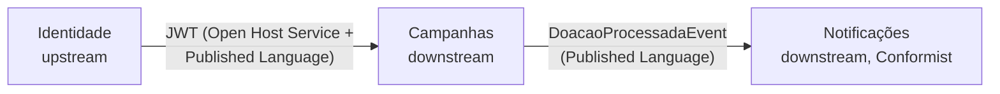

# 06 — Modelo de domínio (DDD)

[← README](../../README.md) · Anterior: [05 — Requisitos não funcionais](requisitos-nao-funcionais.md) · Próximo: [07 — Arquitetura](arquitetura.md)

Aplica o design estratégico e tático da Fase 1 (`wiki:disciplinas/ddd`, `wiki:boas-praticas/ddd`).

## 6.1 Subdomínios

| Subdomínio | Tipo | Justificativa |
|---|---|---|
| Arrecadação (campanhas e doações) | **Principal** (core) | É o motivo da plataforma; onde está a regra de negócio relevante |
| Transparência | Suporte | Leitura pública derivada da arrecadação |
| Identidade e acesso | Genérico | Problema comum; resolvido com padrões conhecidos (JWT, BCrypt) |
| Notificações | Genérico | Envio de recibos; simulado |

O esforço de modelagem tática (agregados, value objects, eventos) vai para **Arrecadação**. Identidade usa um modelo simples.

## 6.2 Bounded contexts

| Contexto | Componentes | Dono dos dados |
|---|---|---|
| **Identidade** | `Identity.Api` | `identity_db` |
| **Campanhas** (Arrecadação + Transparência) | `Campanhas.Api`, `Arrecadacao.Worker` | `campanhas_db`, MongoDB, Redis, Elasticsearch |
| **Notificações** | `Notificacoes.Function` | Nenhum (sem estado) |

## 6.3 Mapa de contextos

| Relação | Padrão | Detalhe |
|---|---|---|
| Identidade → Campanhas | Open Host Service + Published Language | O JWT é o contrato publicado; Campanhas lê só `sub` e `role` |
| Campanhas → Notificações | Published Language; Notificações é Conformist | Notificações aceita o contrato do evento como está |

Não há chamadas síncronas entre serviços: Campanhas não consulta Identidade em tempo de execução.

## 6.4 Event Storming (resultado esperado)

Fluxo "Doar" em notação de Event Storming (laranja = evento, azul = comando, amarelo = ator, lilás = política, rosa = sistema externo):

| Ordem | Ator | Comando | Agregado | Evento | Política seguinte |
|---|---|---|---|---|---|
| 1 | Visitante | Cadastrar doador | Usuario | DoadorCadastrado | — |
| 2 | Doador | Entrar | Usuario | DoadorAutenticado | — |
| 3 | Gestor | Criar campanha | Campanha | CampanhaCriada | Ao criar campanha, indexar para busca |
| 4 | Doador | Doar | Campanha (validação) | DoacaoRecebida | Ao receber doação, processar |
| 5 | Worker | Processar doação | Campanha | DoacaoProcessada | Ao processar, emitir recibo e atualizar o painel |
| 6 | Função | Emitir recibo | — | ReciboEmitido | — |
| 7 | Gestor | Concluir ou cancelar campanha | Campanha | CampanhaConcluida / CampanhaCancelada | Ao encerrar, reindexar |

O quadro do Miro é exportado para `docs/ddd/event-storming-*.png` na Etapa 2.

## 6.5 Agregado `Campanha`

**Raiz:** `Campanha`. Contexto: Campanhas.

| Membro | Tipo | Observação |
|---|---|---|
| `Id` | `CampanhaId` (GUID v7) | Identidade |
| `Titulo` | `string` | 3–120 caracteres |
| `Descricao` | `string` | Até 2000 caracteres |
| `Periodo` | `Periodo` (VO) | `DataInicio`, `DataFim` |
| `MetaFinanceira` | `Dinheiro` (VO) | > 0 |
| `TotalArrecadado` | `Dinheiro` (VO) | ≥ 0; alterado só por `RegistrarDoacaoProcessada` |
| `Status` | `StatusCampanha` | `Ativa`, `Concluida`, `Cancelada` |
| `Versao` | `uint` | Concorrência otimista (`xmin`) |

**Métodos e invariantes:**

| Método | Pré-condição | Efeito | Erro |
|---|---|---|---|
| `Criar(titulo, descricao, periodo, meta, hoje)` | `periodo.DataFim ≥ hoje`; `meta > 0` | Status `Ativa`, total 0 | `campanha.data_fim_passada`, `campanha.meta_invalida` |
| `Atualizar(titulo, descricao, periodo, meta, hoje)` | Status `Ativa` + mesmas regras | Altera dados | `campanha.nao_editavel` |
| `Concluir()` | Status `Ativa` | Status `Concluida` | `campanha.transicao_invalida` |
| `Cancelar()` | Status `Ativa` | Status `Cancelada` | `campanha.transicao_invalida` |
| `PodeReceberDoacao(hoje)` | — | `true` se `Ativa` e `DataInicio ≤ hoje ≤ DataFim` | — |
| `RegistrarDoacaoProcessada(valor)` | `valor > 0` | Soma ao total (aceita mesmo se encerrada depois do aceite) | `doacao.valor_invalido` |
| `PercentualAtingido` | — | `Total / Meta × 100`, 2 casas | — |

Na prática, o Worker soma o total com `UPDATE` atômico no banco ([10 — Dados](dados.md)) por desempenho e para evitar conflito de concorrência; o método `RegistrarDoacaoProcessada` documenta e testa a regra, e o `UPDATE` reproduz a mesma regra.

Erros de domínio são retornados como `Result` (sem exceções para fluxo de negócio) e convertidos em 422 na API.

## 6.6 Agregado `Usuario`

**Raiz:** `Usuario`. Contexto: Identidade.

| Membro | Tipo | Observação |
|---|---|---|
| `Id` | `UsuarioId` (GUID v7) | Vai no `sub` do JWT |
| `NomeCompleto` | `string` | |
| `Email` | `Email` (VO) | Normalizado em minúsculas |
| `Cpf` | `Cpf` (VO) | Só para doadores; persistido cifrado |
| `SenhaHash` | `string` | BCrypt |
| `Role` | `Role` | `GestorONG` ou `Doador` |
| `Consentimento` | `Consentimento` (VO) | Versão da política e data do aceite |
| `AnonimizadoEm` | `DateTimeOffset?` | |

| Método | Regra |
|---|---|
| `CadastrarDoador(...)` | Role sempre `Doador`; exige consentimento |
| `CriarGestor(...)` | Só usado pelo seed |
| `VerificarSenha(senha, hasher)` | Falso se anonimizado |
| `Anonimizar(agora)` | Substitui dados pessoais e marca `AnonimizadoEm`; idempotente |

## 6.7 Value objects

| VO | Regra | Igualdade |
|---|---|---|
| `Dinheiro` | `decimal`, 2 casas (arredondamento bancário), não negativo | Por valor |
| `Periodo` | `DataFim ≥ DataInicio` (tipos `DateOnly`) | Por valor |
| `Email` | Formato válido, até 254, minúsculas | Por valor normalizado |
| `Cpf` | 11 dígitos, dígitos verificadores válidos, sem sequência repetida; `Mascarado()` → `***.456.789-**` | Por dígitos |
| `Senha` | Política do RF03 (só validação; nunca armazenada) | — |
| `Consentimento` | Versão não vazia e data | Por valor |

Implementados como `record` imutáveis com construtor privado e fábrica `Criar(...)` que retorna `Result<T>`.

## 6.8 Eventos de domínio e de integração

| Evento | Tipo | Onde nasce | Quem consome |
|---|---|---|---|
| `CampanhaCriada`, `CampanhaAtualizada`, `CampanhaConcluida`, `CampanhaCancelada` | Domínio | Agregado `Campanha` | Handler interno que publica `CampanhaAlteradaEvent` (integração) |
| `DoacaoRecebidaEvent` | Integração | Caso de uso `ReceberDoacao` | `Arrecadacao.Worker` |
| `DoacaoProcessadaEvent` | Integração | `Arrecadacao.Worker` | `Notificacoes.Function` |

Eventos de domínio ficam dentro do contexto. Só eventos de integração (contratos em `BuildingBlocks.Contracts`) cruzam fronteiras.

## 6.9 Serviços de domínio e casos de uso

| Caso de uso (Application) | Contexto | Entrada | Saída |
|---|---|---|---|
| `CadastrarDoador` | Identidade | `CadastrarDoadorRequest` | `DoadorResponse` |
| `Autenticar` | Identidade | `LoginRequest` | `TokenResponse` |
| `ObterMeusDados` / `AnonimizarMeusDados` | Identidade | `UsuarioId` | `DoadorResponse` / — |
| `CriarCampanha`, `AtualizarCampanha`, `AlterarStatusCampanha` | Campanhas | DTOs de entrada | `CampanhaResponse` |
| `ListarCampanhas`, `ObterCampanha` | Campanhas | Filtros | DTOs de leitura |
| `ObterPainelTransparencia` | Campanhas | — | `PainelItemResponse[]` |
| `BuscarCampanhas` | Campanhas | `q`, paginação | `BuscaResponse` |
| `ReceberDoacao` | Campanhas | `DoacaoRequest`, `UsuarioId` | `DoacaoAceitaResponse` |
| `ProcessarDoacao` | Campanhas (Worker) | `DoacaoRecebidaEvent` | — |

Cada caso de uso é uma classe com um método `ExecutarAsync` (SRP), recebe dependências por construtor e não conhece HTTP.

## 6.10 Domain Storytelling

História "Maria doa para o Natal Solidário" (pictográfica no Miro, exportada para `docs/ddd/domain-storytelling-doacao.png`):

1. O **gestor** cria a **campanha** "Natal Solidário" com meta de R$ 10.000.
2. A **visitante** Maria se cadastra como **doadora**.
3. Maria **entra** e escolhe a campanha no **painel**.
4. Maria **doa** R$ 150.
5. A **plataforma** confirma o recebimento.
6. O **processador** soma a doação ao **total arrecadado**.
7. A **plataforma** emite o **recibo** para Maria.
8. Qualquer **visitante** vê o novo total no **painel**.
