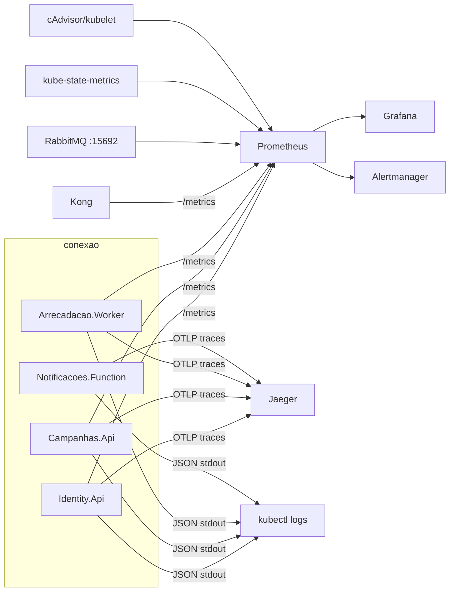

# 12 — Observabilidade

[← README](../../README.md) · Anterior: [11 — Segurança e LGPD](seguranca-e-lgpd.md) · Próximo: [13 — Infraestrutura](../../docs/spec/13-infraestrutura.md)

Atende ao requisito "Observabilidade (Zabbix e Grafana)" do enunciado e ao conteúdo da Fase 3. Referências: `wiki:disciplinas/monitoramento-acesso`, `wiki:disciplinas/monitoramento-acesso-avancado`, `wiki:conceitos/golden-metrics`, `wiki:conceitos/prometheus-net`, `wiki:conceitos/promql`.

## 12.1 Visão geral

| Sinal | Ferramenta | Como |
|---|---|---|
| Métricas | prometheus-net + Prometheus | `/metrics`, coletado por `ServiceMonitor` (pull, 15 s) |
| Traces | OpenTelemetry .NET + Jaeger | OTLP gRPC na porta 4317 |
| Logs | Serilog (JSON compacto) | stdout, lido por `kubectl logs`; `traceId` em cada linha |
| Dashboards | Grafana | Provisionado como código |
| Alertas | Prometheus + Alertmanager | `PrometheusRule` versionado |
| Disponibilidade externa (opcional) | Zabbix | Cenário web em `/health/ready` |

## 12.2 Health checks

| Rota | Verifica | Usada por |
|---|---|---|
| `/health/live` | Só o processo | `livenessProbe` |
| `/health/ready` | PostgreSQL, RabbitMQ, Redis, MongoDB, Elasticsearch (conforme o serviço) | `readinessProbe`, Zabbix |

Pacotes `AspNetCore.HealthChecks.*` (NpgSql, Rabbitmq, Redis, MongoDb, Elasticsearch). Resposta JSON com status por dependência. O Elasticsearch é marcado como `Degraded` (não derruba a prontidão), porque só a busca depende dele.

## 12.3 Métricas

### Técnicas (automáticas)
| Métrica | Origem |
|---|---|
| `http_requests_received_total{code,method,endpoint}` | prometheus-net `UseHttpMetrics()` |
| `http_request_duration_seconds_bucket{...}` | prometheus-net |
| `dotnet_*`, `process_*` (GC, threads, memória) | prometheus-net |
| `container_cpu_usage_seconds_total`, `container_memory_working_set_bytes` | kubelet/cAdvisor |
| `kube_pod_container_status_restarts_total`, `kube_deployment_status_replicas_available` | kube-state-metrics |
| `rabbitmq_queue_messages_ready{queue}` | Plugin `rabbitmq_prometheus` (com métricas por objeto habilitadas) |
| `kong_http_requests_total`, `kong_request_latency_ms_bucket` | Plugin `prometheus` do Kong |

### De negócio (customizadas)
| Métrica | Tipo | Labels | Onde |
|---|---|---|---|
| `doacoes_recebidas_total` | Counter | — | Campanhas.Api, ao aceitar a doação |
| `doacoes_recusadas_total` | Counter | `motivo` (`campanha_nao_ativa`, `validacao`) | Campanhas.Api |
| `doacoes_processadas_total` | Counter | `resultado` (`processada`, `duplicada`) | Worker |
| `doacoes_valor_reais_total` | Counter | — | Worker |
| `doacao_atraso_processamento_segundos` | Histogram | — | Worker (`ProcessadaEm - RecebidaEm`) |
| `campanhas_criadas_total` | Counter | — | Campanhas.Api |
| `recibos_emitidos_total` | Counter | — | Função (exposto via log; métrica opcional) |

Regra: labels de **baixa cardinalidade** (nunca `campanhaId`, `doadorId` ou URL completa).

## 12.4 Dashboard Grafana "Conexão Solidária"

Arquivo `deploy/observability/dashboards/conexao-solidaria.json`, carregado por ConfigMap com o label `grafana_dashboard: "1"` (sidecar do kube-prometheus-stack). Variáveis: `namespace`, `servico`.

| Linha | Painel | PromQL |
|---|---|---|
| Tráfego | Requisições/s por serviço | `sum by (job) (rate(http_requests_received_total[1m]))` |
| Latência | p95 por serviço | `histogram_quantile(0.95, sum by (le, job) (rate(http_request_duration_seconds_bucket[5m])))` |
| Erros | % de 5xx por serviço | `sum by (job) (rate(http_requests_received_total{code=~"5.."}[5m])) / sum by (job) (rate(http_requests_received_total[5m]))` |
| Saturação | CPU por pod | `sum by (pod) (rate(container_cpu_usage_seconds_total{namespace="conexao",container!=""}[2m]))` |
| Saturação | Memória por pod | `sum by (pod) (container_memory_working_set_bytes{namespace="conexao",container!=""})` |
| Negócio | Doações processadas (5 min) | `sum(increase(doacoes_processadas_total{resultado="processada"}[5m]))` |
| Negócio | Valor arrecadado (stat) | `sum(doacoes_valor_reais_total)` |
| Negócio | Atraso de processamento p95 | `histogram_quantile(0.95, sum by (le) (rate(doacao_atraso_processamento_segundos_bucket[5m])))` |
| Mensageria | Mensagens prontas por fila | `sum by (queue) (rabbitmq_queue_messages_ready)` |
| Mensageria | Mensagens na DLQ | `sum(rabbitmq_queue_messages_ready{queue=~".*_error"})` |
| Plataforma | Réplicas disponíveis | `kube_deployment_status_replicas_available{namespace="conexao"}` |
| Plataforma | Reinícios de pods (1 h) | `sum by (pod) (increase(kube_pod_container_status_restarts_total{namespace="conexao"}[1h]))` |
| Gateway | Requisições por rota no Kong | `sum by (route) (rate(kong_http_requests_total[1m]))` |

Boas práticas: unidades corretas (s, %, bytes, R$), descrição em cada painel dizendo o que fazer quando o valor estiver ruim, dashboard em pasta própria, admin padrão do Grafana desativado (senha em Secret).

## 12.5 Alertas (`deploy/observability/alerts/prometheus-rules.yaml`)

| Alerta | Expressão (resumo) | Duração | Severidade | Ação (runbook) |
|---|---|---|---|---|
| `TaxaDeErros5xxAlta` | 5xx > 5% por serviço | 5 min | crítica | Ver logs com o `traceId` das falhas; checar `/health/ready` |
| `LatenciaPainelAlta` | p95 do painel > 300 ms | 10 min | aviso | Checar Redis e consulta do painel |
| `MensagensNaDLQ` | `_error` > 0 | 1 min | crítica | Inspecionar a mensagem no RabbitMQ; corrigir e reenviar |
| `FilaDoacoesAcumulando` | `doacao-recebida` > 100 | 5 min | aviso | Ver réplicas do Worker e KEDA |
| `PodReiniciando` | > 3 reinícios em 15 min | — | aviso | `kubectl describe pod`; ver probes e limites de memória |
| `ServicoSemReplicas` | réplicas disponíveis = 0 | 1 min | crítica | `kubectl get events` |

Runbooks em `docs/runbooks/<alerta>.md`. No ambiente local, o Alertmanager só registra (sem integração externa); opcionalmente, webhook para um canal do Discord.

## 12.6 Traces

| Item | Definição |
|---|---|
| SDK | `OpenTelemetry.Extensions.Hosting` |
| Instrumentações | ASP.NET Core, HttpClient, Npgsql (`Npgsql.OpenTelemetry`), MassTransit (`ActivitySource` "MassTransit"), Redis, MongoDB, Elasticsearch |
| Propagação | W3C `traceparent` em HTTP e nos headers das mensagens |
| Recurso | `service.name`, `service.version` (tag da imagem), `deployment.environment` |
| Amostragem | 100% no local; `ParentBased(TraceIdRatio 0.2)` na cloud opcional |
| Spans de negócio | `ReceberDoacao`, `ProcessarDoacao`, `EmitirRecibo` com atributos `doacao.id`, `campanha.id` (sem dados pessoais) |
| Destino | Jaeger all-in-one (armazenamento em memória no local) |

Resultado esperado no vídeo: um único trace com spans do Kong/API → publicação → consumo no Worker → consumo na Função.

## 12.7 Logs

| Item | Definição |
|---|---|
| Biblioteca | Serilog (`Serilog.AspNetCore`, formatter `RenderedCompactJsonFormatter`) |
| Destino | stdout |
| Enriquecimento | `traceId`, `spanId`, `service`, `version`, `environment` |
| Níveis | `Information` para eventos de negócio, `Warning` para anomalias tratadas, `Error` quando exige ação; `Debug` desligado fora do local |
| Mensagens | Templates estruturados (`"Doação {DoacaoId} processada para a campanha {CampanhaId}"`), nunca interpolação |
| Proibido | Senha, token, CPF, e-mail, nome |
| Ruído | Requisições a `/health` e `/metrics` não são logadas |
| Request logging | `UseSerilogRequestLogging` com método, rota, status e duração |

## 12.8 Zabbix (opcional)

O título do enunciado cita Zabbix; o critério verificável é o Grafana. Opcionalmente:

1. `docker compose --profile zabbix up -d` sobe Zabbix server, web e banco.
2. Host "Conexão Solidária" com **cenário web** para `/health/ready` de cada serviço (via `minikube tunnel` ou port-forward).
3. Trigger: falha no cenário por 2 verificações seguidas.
4. Plugin de Zabbix no Grafana (opcional) para mostrar os dois no mesmo dashboard.

Referências: `wiki:conceitos/zabbix`, `wiki:conceitos/zabbix-hosts-itens-triggers-templates`.
