# Roadmap de implementação

[← README](../README.md) · [Constituição](constitution.md) · [Plano de execução](../docs/plano-de-execucao.md)

Todas as tarefas do projeto, **uma a uma, em ordem lógica de execução**: 251 itens numerados de `R001` a `R251`. O roadmap junta as tarefas das 9 [features](features/), a fundação da Etapa 3 e as etapas de infraestrutura e entrega do [plano de execução](../docs/plano-de-execucao.md).

## Como usar

1. Siga a ordem `R001 → R251`. Uma tarefa só começa quando as anteriores da mesma fase terminaram e as dependências indicadas em **Depende de** estão concluídas.
2. Itens `NNN/Tnnn` são tarefas dos `tasks.md` das features (fonte da verdade da descrição e da mensagem de commit). Para executá-las: `/implement NNN Tnnn Tfinal` (início e fim opcionais).
3. Itens sem `NNN/Tnnn` são da fundação ou da infraestrutura e trazem a mensagem de commit pronta. Os marcados **manual** não geram commit (configuração no GitHub, medições, gravação).
4. Marque cada item `[X]` ao concluir, no mesmo commit da tarefa quando houver commit.
5. Toda tarefa respeita a [constituição](constitution.md): TDD, testes de sucesso e de erro, cobertura ≥ 90%, `/// 
`, commit que compila.

Tarefas **adiadas** para outra fase (por dependerem de algo que só existe depois) levam a marca ↪ com o motivo. A lista completa está em [tarefas fora da ordem do `tasks.md`](#tarefas-fora-da-ordem-do-tasksmd).

## Visão geral das fases

| Fase | Nome | Etapas do plano | Sprint | Itens | Quantidade |
|---|---|---|---|---|---|
| 1 | [Preparação](#fase-1) | 0 a 2 | 0 | R001 a R014 | 14 |
| 2 | [Fundação e pipeline com cobertura](#fase-2) | 3 (feature 009) | 0 | R015 a R047 | 33 |
| 3 | [Identidade](#fase-3) | 4 (features 001, 003 e 008) | 1 | R048 a R083 | 36 |
| 4 | [Campanhas e painel](#fase-4) | 5 (features 002 e 004) | 1 | R084 a R109 | 26 |
| 5 | [Doação assíncrona](#fase-5) | 6 (feature 005) | 2 | R110 a R125 | 16 |
| 6 | [Busca e recibo](#fase-6) | 5 e 7 (features 006 e 007) | 2 | R126 a R145 | 20 |
| 7 | [Interface Blazor](#fase-7) | 8 | 2 | R146 a R158 | 13 |
| 8 | [Testes complementares](#fase-8) | 9 | 2 | R159 a R163 | 5 |
| 9 | [Containers](#fase-9) | 10 | 3 | R164 a R173 | 10 |
| 10 | [Kubernetes local](#fase-10) | 11 | 3 | R174 a R192 | 19 |
| 11 | [API Gateway (Kong)](#fase-11) | 12 | 3 | R193 a R201 | 9 |
| 12 | [Testes de carga](#fase-12) | 9 (k6) | 3 | R202 a R205 | 4 |
| 13 | [Observabilidade e escala por eventos](#fase-13) | 13 | 3 | R206 a R216 | 11 |
| 14 | [CI/CD complementar](#fase-14) | 14 | 3 | R217 a R224 | 8 |
| 15 | [Nuvem na Azure *(opcional)*](#fase-15) | 15 | 4 | R225 a R230 | 6 |
| 16 | [Segurança e LGPD](#fase-16) | 16 | 4 | R231 a R234 | 4 |
| 17 | [Documentação final](#fase-17) | 17 | 4 | R235 a R239 | 5 |
| 18 | [Vídeo](#fase-18) | 18 | 4 | R240 a R244 | 5 |
| 19 | [Conclusão](#fase-19) | 19 | 4 | R245 a R251 | 7 |

```mermaid
flowchart LR
  F1["1. Preparação"]
  F2["2. Fundação e pipeline com cobertura"]
  F3["3. Identidade"]
  F4["4. Campanhas e painel"]
  F5["5. Doação assíncrona"]
  F6["6. Busca e recibo"]
  F7["7. Interface Blazor"]
  F8["8. Testes complementares"]
  F9["9. Containers"]
  F10["10. Kubernetes local"]
  F11["11. API Gateway (Kong)"]
  F12["12. Testes de carga"]
  F13["13. Observabilidade e escala por eventos"]
  F14["14. CI/CD complementar"]
  F15(["15. Nuvem na Azure"])
  F16["16. Segurança e LGPD"]
  F17["17. Documentação final"]
  F18["18. Vídeo"]
  F19["19. Conclusão"]
  F1 --> F2 --> F3 --> F4 --> F5 --> F6 --> F7 --> F8
  F8 --> F9 --> F10 --> F11 --> F12 --> F13 --> F14
  F14 --> F15
  F14 --> F16 --> F17 --> F18 --> F19
  F15 -.-> F16
```

## Marcos

| Marco | Quando | O que está funcionando |
|---|---|---|
| M1 — Requisito avaliado | Fim da Fase 2 (R047) | Pipeline executando os testes unitários, mostrando a cobertura e publicando o artefato para download |
| M2 — Domínio testado | Fim da Fase 5 (R125) | Identidade, campanhas, painel e doação com testes de sucesso e de erro e cobertura ≥ 90% |
| M3 — Produto completo | Fim da Fase 8 (R163) | Todas as funcionalidades, interface e testes complementares |
| M4 — Plataforma | Fim da Fase 14 (R224) | Containers, Kubernetes, gateway, carga, observabilidade e CI/CD completo |
| M5 — Entrega | Fim da Fase 19 (R251) | Vídeo publicado e entrega registrada |

Se faltar tempo, o que pode ser cortado e em que ordem está em [entrega e riscos](../docs/entrega-e-riscos.md#ordem-de-corte-se-faltar-tempo). **As Fases 1, 2 e as fases de features (3 a 6) nunca são cortadas**: elas entregam o requisito avaliado.

## Fase 1 — Preparação

**Etapas do plano:** 0 a 2 · **Sprint:** 0 · **Itens:** R001 a R014

**Objetivo:** Máquina, contas, repositório e backlog prontos antes da primeira linha de código.

**Pronto quando:** Pré-requisitos verificados; colaboradores e proteção de segredos ligados; Project, issues, DoR/DoD e modelos criados; specs revisadas com `/analyze` sem achados críticos.

- [ ] **R001** · *[manual]* Rodar os comandos de verificação dos [pré-requisitos](../docs/pre-requisitos.md) e conferir o Minikube com o nó `Ready`
- [ ] **R002** · *[manual]* Adicionar os integrantes como colaboradores do repositório `Kulessa/Trabalho`
- [ ] **R003** · *[manual]* Ligar secret scanning e push protection (Settings → Code security)
- [ ] **R004** · *[manual]* Criar o GitHub Project com colunas, campos e labels do [processo ágil](../docs/processo-agil.md)
- [ ] **R005** · *[manual]* Criar uma issue por feature (001 a 009) e por tarefa técnica (T01–T04), com link para a `spec.md`; estimar com Planning Poker
- [ ] **R006** · *[manual]* Revisar cada spec em grupo: `/analyze NNN` e, se houver pendência, `/clarify NNN`
- [X] **R007** · Escrever a Definition of Ready em `docs/agil/definition-of-ready.md`
  Commit: `📝 docs(agil): adiciona definition of ready`
- [X] **R008** · Escrever a Definition of Done em `docs/agil/definition-of-done.md`
  Commit: `📝 docs(agil): adiciona definition of done`
- [X] **R009** · Exportar o Event Storming do fluxo de doação (Miro) para `docs/ddd/`
  Commit: `📝 docs(ddd): adiciona event storming do fluxo de doação`
- [X] **R010** · Exportar o Event Storming do fluxo de campanha (Miro) para `docs/ddd/`
  Commit: `📝 docs(ddd): adiciona event storming do fluxo de campanha`
- [X] **R011** · Exportar o Domain Storytelling da doação para `docs/ddd/`
  Commit: `📝 docs(ddd): adiciona domain storytelling da doação`
- [X] **R012** · Escrever o mapa de contextos em `docs/ddd/context-map.md`
  Commit: `📝 docs(ddd): adiciona mapa de contextos`
- [X] **R013** · Criar o modelo de issue de história em `.github/ISSUE_TEMPLATE/historia.md`
  Commit: `📝 docs: adiciona modelo de issue de história`
- [X] **R014** · Criar o modelo de pull request em `.github/pull_request_template.md`
  Commit: `📝 docs: adiciona modelo de pull request`

## Fase 2 — Fundação e pipeline com cobertura

**Etapas do plano:** 3 (feature 009) · **Sprint:** 0 · **Itens:** R015 a R047

**Objetivo:** Solução compilando, hooks de qualidade e a **pipeline que executa os testes unitários e retorna a cobertura**, que é o requisito avaliado.

**Pronto quando:** `dotnet build -warnaserror` e `dotnet test` passam local e no CI; mensagem de commit fora do padrão é bloqueada; a pipeline mostra a cobertura no resumo e oferece o artefato `cobertura-testes-unitarios` para download; execução manual validada.

- [X] **R015** · SDK fixado em `global.json`
  Commit: `🔧 chore: adiciona global.json com SDK 10`
- [X] **R016** · Estilo de código e severidades dos analisadores em `.editorconfig`
  Commit: `🔧 chore: adiciona .editorconfig`
- [X] **R017** · Fim de linha e arquivos binários em `.gitattributes`
  Commit: `🔧 chore: adiciona .gitattributes`
- [X] **R018** · `Directory.Build.props` com `TreatWarningsAsErrors`, nullable e documentação XML
  Commit: `🔧 chore: adiciona Directory.Build.props com avisos como erro`
- [X] **R019** · `Directory.Packages.props` com gestão central de versões
  Commit: `🔧 chore: adiciona Directory.Packages.props com gestão central de pacotes`
- [X] **R020** · StyleCop com as regras de documentação (`stylecop.json`) e severidades no `.editorconfig`
  Commit: `🔧 chore: adiciona stylecop para exigir documentação xml`
- [X] **R021** · Criar a solução `ConexaoSolidaria.slnx`
  Commit: `🎉 chore: cria solução ConexaoSolidaria`
- [X] **R022** · Projeto `ConexaoSolidaria.Contracts`, já na solução
  Commit: `🎉 chore(contracts): cria projeto ConexaoSolidaria.Contracts`
- [X] **R023** · Projeto `ConexaoSolidaria.ServiceDefaults`, já na solução
  Commit: `🎉 chore(defaults): cria projeto ConexaoSolidaria.ServiceDefaults`
- [X] **R024** · Projetos `Identity.Domain`, `Application`, `Infrastructure` e `Api`
  Commit: `🎉 chore(identity): cria projetos Domain, Application, Infrastructure e Api`
- [X] **R025** · Projetos `Campanhas.Domain`, `Application`, `Infrastructure`, `Api` e `Arrecadacao.Worker`
  Commit: `🎉 chore(campanhas): cria projetos Domain, Application, Infrastructure, Api e Worker`
- [X] **R026** · Projeto `Notificacoes.Function`
  Commit: `🎉 chore(notificacoes): cria projeto Notificacoes.Function`
- [X] **R027** · Projeto `ConexaoSolidaria.Web`
  Commit: `🎉 chore(web): cria projeto ConexaoSolidaria.Web`
- [X] **R028** · `009/T001` [H11] Projetos `tests/unit/*.UnitTests` com xUnit v3, Shouldly e NSubstitute, incluídos na `.slnx` — `tests/unit/*/*.csproj`
  Commit: `✅ test: cria projetos de testes unitários com xunit`
- [X] **R029** · Projetos de teste de integração, contrato e e2e (vazios, com os pacotes), já na solução
  Commit: `✅ test: cria projetos de testes de integração, contrato e e2e`
- [X] **R030** · `009/T002` [H11] Teste de arquitetura das camadas (passa com as dependências permitidas e acusa dependência proibida) — `tests/unit/*/ArquiteturaTests.cs`
  Commit: `✅ test: adiciona teste de arquitetura das camadas`
  Depende de: R028 (`009/T001`)
- [X] **R031** · `ServiceDefaults`: logs estruturados com Serilog, com testes de sucesso e de erro
  Commit: `🔊 feat(defaults): adiciona logs estruturados com serilog`
- [X] **R032** · `ServiceDefaults`: OpenTelemetry e `/metrics`, com testes
  Commit: `📈 feat(defaults): adiciona tracing com opentelemetry e endpoint de métricas`
- [X] **R033** · `ServiceDefaults`: `/health/live` e `/health/ready`, com testes
  Commit: `🩺 feat(defaults): adiciona health checks live e ready`
- [X] **R034** · `ServiceDefaults`: tratamento global de erros com `ProblemDetails`, com testes
  Commit: `🥅 feat(defaults): adiciona tratamento global de erros com problem details`
- [X] **R035** · Manifesto de ferramentas locais (`dotnet-ef`, `husky`)
  Commit: `🔧 chore: adiciona manifesto de ferramentas dotnet`
- [X] **R036** · `009/T004` [H12] ReportGenerator no manifesto de ferramentas — `.config/dotnet-tools.json`
  Commit: `🔧 chore: adiciona reportgenerator ao manifesto de ferramentas`
- [X] **R037** · `009/T003` [H12] `coverlet.runsettings` com filtros e exclusões — `coverlet.runsettings`
  Commit: `🔧 chore: adiciona configuração de cobertura com coverlet`
- [X] **R038** · `009/T005` [H12] Script de verificação da cobertura mínima (`-Minimo`, `-ExecutarTestes`) — `scripts/verificar-cobertura.ps1`
  Commit: `🔧 chore: adiciona script de verificação da cobertura mínima de 90%`
  Depende de: R037 (`009/T003`), R036 (`009/T004`)
- [X] **R039** · Script `scripts/validar-mensagem-commit.ps1` (regex do guia de commits e lista de gitmojis)
  Commit: `🔧 chore: adiciona script de validação da mensagem de commit`
- [X] **R040** · Hooks do Husky.Net: `pre-commit` (formato, build, testes de unidade), `commit-msg` e `pre-push` (cobertura mínima de 90%)
  Commit: `🔧 chore: adiciona hooks do husky para build, formato e mensagem`
- [X] **R041** · `009/T006` [H11] Workflow `ci.yml` com gatilhos `push`, `pull_request` e `workflow_dispatch` e job `testes-unitarios` (build, testes `Category=Unit`, cobertura, resumo e artefatos) — `.github/workflows/ci.yml`
  Commit: `👷 ci: adiciona pipeline com testes unitários e cobertura`
  Depende de: R030 (`009/T002`)
- [X] **R042** · `009/T007` [H12] Job `testes-integracao` com todos os testes, artefato `cobertura-total` e mínimo de 90% — `.github/workflows/ci.yml`
  Commit: `👷 ci: adiciona testes de integração e cobertura mínima na pipeline`
  Depende de: R038 (`009/T005`), R041 (`009/T006`)
- [X] **R043** · `009/T008` [H11] Badge do status da pipeline e seção "Testes e cobertura" no README — `README.md`
  Commit: `📝 docs: adiciona status da pipeline e cobertura no readme`
  Depende de: R042 (`009/T007`)
- [X] **R044** · Atualizar o `CLAUDE.md` com os comandos reais da solução
  Commit: `📝 docs: atualiza CLAUDE.md com os comandos reais da solução`
- [X] **R045** · Script `scripts/verificar-pre-requisitos.ps1`
  Commit: `🔧 chore: adiciona script de verificação de pré-requisitos`
- [ ] **R046** · `009/T009` [H12] Verificar a falha da pipeline com um teste quebrado numa branch de teste (não vai para a `main`) e registrar o resultado no PR
  Depende de: R043 (`009/T008`)
- [ ] **R047** · `009/T010` [H11] Executar a pipeline manualmente, baixar o artefato e conferir o relatório HTML
  Depende de: R046 (`009/T009`)

## Fase 3 — Identidade

**Etapas do plano:** 4 (features 001, 003 e 008) · **Sprint:** 1 · **Itens:** R048 a R083

**Objetivo:** Login com JWT, cadastro de doador e direitos do titular na `Identity.Api`, com testes de sucesso e de erro.

**Pronto quando:** Cenários das features 001, 003 e 008 passando; `/security-review` sem pendências críticas; cobertura ≥ 90% nos projetos de Identity.

- [X] **R048** · `001/T001` [H02] Value object `Email` com normalização e validação, com testes — `Identity.Domain/Usuarios/Email.cs`, `tests/unit/Identity.UnitTests/Usuarios/EmailTests.cs`
  Commit: `✨ feat(identity): adiciona value object Email`
- [X] **R049** · `001/T002` [H02] `Role`, `UsuarioId` e agregado `Usuario` com `CriarGestor` e `VerificarSenha`, com testes — `Identity.Domain/Usuarios/*`
  Commit: `✨ feat(identity): adiciona agregado Usuario com verificação de senha`
  Depende de: R048 (`001/T001`)
- [X] **R050** · `001/T003` [H02] Entidade `TentativaLogin` com janela de 15 min e bloqueio na 5ª falha, com testes — `Identity.Domain/Autenticacao/TentativaLogin.cs`
  Commit: `✨ feat(identity): adiciona controle de tentativas de login`
- [X] **R051** · `001/T004` [H02] Interfaces `IUsuarioRepositorio`, `IHasherEmail`, `IEmissorToken`, `ITentativaLoginRepositorio` — `Identity.Application/Abstracoes/*` (`IHasherSenha` ficou no domínio, porque `Usuario.VerificarSenha` a usa)
  Commit: `🏷️ feat(identity): adiciona abstrações de autenticação`
- [X] **R052** · `001/T005` [H02] Caso de uso `Autenticar` com validador e testes (sucesso, senha errada, e-mail inexistente com tempo constante, bloqueado, anonimizado) — `Identity.Application/Autenticacao/*`
  Commit: `✨ feat(identity): adiciona caso de uso de autenticação`
  Depende de: R049 (`001/T002`), R050 (`001/T003`), R051 (`001/T004`)
- [X] **R053** · `001/T006` [H02] `IdentityDbContext`, configurações de `usuarios` e `tentativas_login` e migration inicial — `Identity.Infrastructure/Persistencia/*`
  Commit: `🗃️ feat(identity): adiciona IdentityDbContext e migration inicial`
- [X] **R054** · `001/T007` [H02] `HasherSenhaBcrypt` (work factor 12) com testes — `Identity.Infrastructure/Seguranca/HasherSenhaBcrypt.cs`
  Commit: `🛂 feat(identity): adiciona hash de senha com bcrypt`
- [X] **R055** · `001/T008` [H02] `EmissorJwtRs256` com testes do payload (sem dados pessoais) — `Identity.Infrastructure/Seguranca/EmissorJwtRs256.cs`
  Commit: `🛂 feat(identity): emite jwt rs256 no login`
- [X] **R056** · `001/T009` [H02] Repositórios EF Core com testes de integração (Testcontainers) — `Identity.Infrastructure/Persistencia/Repositorios/*`
  Commit: `🗃️ feat(identity): adiciona repositórios de usuário e tentativas`
  Depende de: R053 (`001/T006`)
- [X] **R057** · `001/T010` [H02] `AddAutenticacaoJwt()` com policies `GestorONG`, `Doador` e `FallbackPolicy`, com testes — `ConexaoSolidaria.ServiceDefaults/Autenticacao/*`
  Commit: `🛂 feat(defaults): adiciona validação de jwt e policies por role`
- [X] **R058** · `001/T011` [H02] Endpoint `POST /auth/login` com `TypedResults` e `ProblemDetails` — `Identity.Api/Endpoints/AutenticacaoEndpoints.cs`
  Commit: `✨ feat(identity): adiciona endpoint de login`
  Depende de: R052 (`001/T005`), R054 (`001/T007`), R055 (`001/T008`), R056 (`001/T009`)
- [X] **R059** · `001/T012` [H02] Seed do gestor por `Seed__GestorEmail`/`Seed__GestorSenha`, com teste de idempotência — `Identity.Infrastructure/Seed/SeedGestorHostedService.cs`
  Commit: `🌱 chore(identity): adiciona seed do gestor por variáveis de ambiente`
- [X] **R060** · `001/T013` [H02] Métrica `logins_total{resultado}` e logs sem e-mail — `Identity.Application/Autenticacao/Autenticar.cs`
  Commit: `📈 feat(identity): adiciona métrica de logins`
- [X] **R061** · `001/T014` [H02] Testes de integração: 200, 401 (dois casos), 429, 401 sem token, seed idempotente; o 403 por role já é testado no ServiceDefaults e entra aqui quando a Identity tiver a primeira rota protegida por papel — `tests/integration/Identity.IntegrationTests/AutenticacaoTests.cs`
  Commit: `✅ test(identity): adiciona testes de integração do login`
  Depende de: R057 (`001/T010`), R058 (`001/T011`), R059 (`001/T012`)
- [X] **R062** · `001/T015` [H02] Cenários Gherkin da spec automatizados (os cenários que dependem do cadastro de doador ou das rotas de campanhas ficam com `@ignore` e são liberados em R075 e R099) — `tests/e2e/ConexaoSolidaria.Bdd/Features/001-autenticacao.feature` e steps
  Commit: `✅ test(bdd): adiciona cenários de autenticação`
  Depende de: R061 (`001/T014`)
- [X] **R063** · `001/T017` `/security-review` e `/code-review`; corrigir apontamentos em commits próprios
- [X] **R064** · `001/T018` Conferir cobertura ≥ 90% (`verificar-cobertura`) e `git rebase --exec` antes do PR
- [X] **R065** · `003/T001` [H01] VO `Cpf` com dígitos verificadores, sequências repetidas e `Mascarado()`, com testes — `Identity.Domain/Usuarios/Cpf.cs`
  Commit: `✨ feat(identity): adiciona value object Cpf com validação de dígitos`
- [X] **R066** · `003/T002` [H01] VO `Senha` com a política de segurança, com testes — `Identity.Domain/Usuarios/Senha.cs`
  Commit: `✨ feat(identity): adiciona value object Senha com política de segurança`
- [X] **R067** · `003/T003` [H01] VO `Consentimento`, com testes — `Identity.Domain/Usuarios/Consentimento.cs`
  Commit: `✨ feat(identity): adiciona value object Consentimento`
- [X] **R068** · `003/T004` [H01] `Usuario.CadastrarDoador` com testes — `Identity.Domain/Usuarios/Usuario.cs`
  Commit: `✨ feat(identity): adiciona cadastro de doador no agregado Usuario`
  Depende de: R065 (`003/T001`), R066 (`003/T002`), R067 (`003/T003`)
- [X] **R069** · `003/T005` [H01] `ICifradorCpf` e caso de uso `CadastrarDoador` com validador e testes (sucesso, 400, 409 e-mail, 409 CPF) — `Identity.Application/Doadores/*`
  Commit: `✨ feat(identity): adiciona caso de uso de cadastro de doador`
  Depende de: R068 (`003/T004`)
- [X] **R070** · `003/T006` [H01] `CifradorCpfAesGcm` (cifra, decifra, hash, versão da chave), com testes — `Identity.Infrastructure/Seguranca/CifradorCpfAesGcm.cs`
  Commit: `🔒️ feat(identity): adiciona cifragem e hash do cpf`
- [X] **R071** · `003/T007` [H01] Configuração EF das colunas de cadastro e migration — `Identity.Infrastructure/Persistencia/*`
  Commit: `🗃️ feat(identity): adiciona colunas de cadastro de doador`
- [X] **R072** · `003/T008` [H01] Endpoint `POST /doadores` (`AllowAnonymous`), tratamento de `23505` como 409 — `Identity.Api/Endpoints/DoadoresEndpoints.cs`
  Commit: `✨ feat(identity): adiciona endpoint de cadastro de doador`
  Depende de: R069 (`003/T005`), R070 (`003/T006`), R071 (`003/T007`)
- [X] **R073** · `003/T009` [H01] Métrica `doadores_cadastrados_total` — `Identity.Application/Doadores/CadastrarDoador.cs`
  Commit: `📈 feat(identity): adiciona métrica de doadores cadastrados`
- [X] **R074** · `003/T010` [H01] Testes de integração: 201, 400 (cada regra), 409 e-mail, 409 CPF, CPF cifrado no banco, log sem dados pessoais — `tests/integration/Identity.IntegrationTests/CadastroDoadorTests.cs`
  Commit: `✅ test(identity): adiciona testes de integração do cadastro de doador`
  Depende de: R072 (`003/T008`)
- [X] **R075** · `003/T011` [H01] Cenários Gherkin automatizados — `tests/e2e/ConexaoSolidaria.Bdd/Features/003-cadastro-doador.feature`
  Commit: `✅ test(bdd): adiciona cenários de cadastro de doador`
  Depende de: R074 (`003/T010`)
- [X] **R076** · `003/T013` `/security-review` e `/code-review`; cobertura ≥ 90%; `git rebase --exec` antes do PR
- [X] **R077** · `008/T001` [H10] `Usuario.Anonimizar` idempotente, com testes (anonimizar, repetir, senha após anonimizar) — `Identity.Domain/Usuarios/Usuario.cs`
  Commit: `✨ feat(identity): adiciona anonimização do usuário`
- [X] **R078** · `008/T002` [H10] Casos de uso `ObterMeusDados` e `AnonimizarMeusDados` com testes — `Identity.Application/Titular/*`
  Commit: `✨ feat(identity): adiciona casos de uso de acesso e anonimização do titular`
  Depende de: R077 (`008/T001`)
- [X] **R079** · `008/T003` [H10] Endpoints `GET` e `DELETE /doadores/me` com policy `Doador` e `Cache-Control: no-store` — `Identity.Api/Endpoints/TitularEndpoints.cs`
  Commit: `✨ feat(identity): adiciona endpoints de acesso e anonimização do titular`
  Depende de: R078 (`008/T002`)
- [X] **R080** · `008/T004` [H10] Log de auditoria `TitularAnonimizado` e métrica `titulares_anonimizados_total` — `Identity.Application/Titular/AnonimizarMeusDados.cs`
  Commit: `🔊 feat(identity): adiciona auditoria da anonimização do titular`
  Depende de: R079 (`008/T003`)
- [X] **R081** · `008/T005` [H10] Testes de integração: 200 com CPF mascarado, 204, colunas anonimizadas no banco, login seguinte 401, `/me` com token antigo 401, e-mail reutilizável — `tests/integration/Identity.IntegrationTests/TitularTests.cs`
  Commit: `✅ test(identity): adiciona testes de integração dos direitos do titular`
  Depende de: R079 (`008/T003`)
- [X] **R082** · `008/T006` [H10] Cenários Gherkin (inclui total da campanha mantido) (o cenário que depende de doação fica com `@ignore` e é liberado em R124) — `tests/e2e/ConexaoSolidaria.Bdd/Features/008-direitos-titular.feature`
  Commit: `✅ test(bdd): adiciona cenários de direitos do titular`
  Depende de: R081 (`008/T005`)
- [X] **R083** · `008/T008` `/security-review` (foco LGPD) e `/code-review`; cobertura ≥ 90%; `git rebase --exec`

## Fase 4 — Campanhas e painel

**Etapas do plano:** 5 (features 002 e 004) · **Sprint:** 1 · **Itens:** R084 a R109

**Objetivo:** Gestão de campanhas e painel público de transparência na `Campanhas.Api`, com evento de alteração no Outbox.

**Pronto quando:** Cenários das features 002 e 004 passando; evento `CampanhaAlteradaEvent` no Outbox a cada alteração; cobertura ≥ 90%.

- [X] **R084** · `002/T001` [H03] `Result` e `Erro` do domínio, com testes — `Campanhas.Domain/Comum/{Result.cs, Erro.cs}`
  Commit: `✨ feat(campanhas): adiciona tipos Result e Erro do domínio`
- [X] **R085** · `002/T002` [H03] Value objects `Dinheiro` e `Periodo`, com testes — `Campanhas.Domain/Comum/*`
  Commit: `✨ feat(campanhas): adiciona value objects Dinheiro e Periodo`
  Depende de: R084 (`002/T001`)
- [X] **R086** · `002/T003` [H03] Agregado `Campanha` com `Criar` e eventos de domínio, com testes — `Campanhas.Domain/Campanhas/*`
  Commit: `✨ feat(campanhas): adiciona agregado Campanha com regras de criação`
  Depende de: R085 (`002/T002`)
- [X] **R087** · `002/T004` [H04] `Atualizar`, `Concluir` e `Cancelar` com testes das transições — `Campanhas.Domain/Campanhas/Campanha.cs`
  Commit: `✨ feat(campanhas): adiciona edição e transições de status da campanha`
  Depende de: R086 (`002/T003`)
- [X] **R088** · `002/T005` [H03] `CampanhaAlteradaEvent` v1 e teste de snapshot JSON — `ConexaoSolidaria.Contracts/V1/CampanhaAlteradaEvent.cs`, `tests/contract/ConexaoSolidaria.ContractTests/*`
  Commit: `🏷️ feat(contracts): adiciona CampanhaAlteradaEvent v1`
  Depende de: R086 (`002/T003`)
- [X] **R089** · `002/T006` [H03] `IRelogio` (hoje em São Paulo) e `ICampanhaRepositorio` — `Campanhas.Application/Abstracoes/*`
  Commit: `🏷️ feat(campanhas): adiciona abstrações de relógio e repositório`
- [X] **R090** · `002/T007` [H03] `CriarCampanha` com validador e testes — `Campanhas.Application/Campanhas/CriarCampanha.cs`
  Commit: `✨ feat(campanhas): adiciona caso de uso de criação de campanha`
  Depende de: R089 (`002/T006`)
- [X] **R091** · `002/T008` [H04] `AtualizarCampanha` e `AlterarStatusCampanha` com testes — `Campanhas.Application/Campanhas/*`
  Commit: `✨ feat(campanhas): adiciona casos de uso de edição e status`
  Depende de: R087 (`002/T004`), R090 (`002/T007`)
- [X] **R092** · `002/T009` [H04] `ListarCampanhas` (paginação e filtro) e `ObterCampanha`, com testes — `Campanhas.Application/Campanhas/*`
  Commit: `✨ feat(campanhas): adiciona listagem e detalhe de campanhas`
- [X] **R093** · `002/T010` [H03] `CampanhasDbContext`, configuração com `xmin` e migration inicial (inclui tabelas do Outbox) — `Campanhas.Infrastructure/Persistencia/*`
  Commit: `🗃️ feat(campanhas): adiciona CampanhasDbContext e migration inicial`
- [X] **R094** · `002/T011` [H03] MassTransit com Outbox EF Core e publicação de `CampanhaAlteradaEvent`, com teste de integração — `Campanhas.Infrastructure/Mensageria/*`
  Commit: `✨ feat(campanhas): publica CampanhaAlteradaEvent via outbox`
  Depende de: R093 (`002/T010`)
- [X] **R095** · `002/T012` [H03] Endpoints `POST`, `GET` (lista e detalhe) com policy `GestorONG` — `Campanhas.Api/Endpoints/CampanhasEndpoints.cs`
  Commit: `✨ feat(campanhas): adiciona endpoints de criação e consulta de campanhas`
  Depende de: R094 (`002/T011`)
- [X] **R096** · `002/T013` [H04] Endpoints `PUT` com `ETag`/`If-Match` e `PATCH /status` — `Campanhas.Api/Endpoints/CampanhasEndpoints.cs`
  Commit: `✨ feat(campanhas): adiciona endpoints de edição e status com etag`
  Depende de: R095 (`002/T012`)
- [X] **R097** · `002/T014` [H03] Métrica `campanhas_criadas_total` — `Campanhas.Application/Campanhas/CriarCampanha.cs`
  Commit: `📈 feat(campanhas): adiciona métrica de campanhas criadas`
- [X] **R098** · `002/T015` [H03] [H04] Testes de integração: 201, 400, 401, 403, 404, 409, 412, 422 e evento no Outbox — `tests/integration/Campanhas.IntegrationTests/CampanhasEndpointsTests.cs`
  Commit: `✅ test(campanhas): adiciona testes de integração da gestão de campanhas`
  Depende de: R096 (`002/T013`)
- [X] **R099** · `002/T016` [H03] [H04] Cenários Gherkin automatizados — `tests/e2e/ConexaoSolidaria.Bdd/Features/002-gestao-campanhas.feature`
  Commit: `✅ test(bdd): adiciona cenários de gestão de campanhas`
  Depende de: R098 (`002/T015`)
- [X] **R100** · `002/T018` `/code-review` e `/simplify`; cobertura ≥ 90%; `git rebase --exec` antes do PR
- [X] **R101** · `004/T001` [H05] `PainelItemResponse`, `ICampanhaLeitura`, `ICachePainel` e caso de uso `ObterPainelTransparencia` com testes (percentual, lista vazia, falha do cache) — `Campanhas.Application/Transparencia/*`
  Commit: `✨ feat(campanhas): adiciona caso de uso do painel de transparência`
- [X] **R102** · `004/T002` [H05] `CampanhaLeituraDapper` com a consulta do painel e teste de integração (filtros de status e período) — `Campanhas.Infrastructure/Leitura/CampanhaLeituraDapper.cs`
  Commit: `✨ feat(campanhas): adiciona consulta do painel com dapper`
  Depende de: R101 (`004/T001`)
- [X] **R103** · `004/T003` [H05] `CachePainelHybrid` com `HybridCache` + Redis, chave versionada e remoção — `Campanhas.Infrastructure/Cache/CachePainelHybrid.cs`
  Commit: `⚡️ feat(campanhas): adiciona cache do painel com hybridcache e redis`
  Depende de: R101 (`004/T001`)
- [X] **R104** · `004/T004` [H05] Invalidação do cache ao criar ou alterar campanha — `Campanhas.Application/Campanhas/*`
  Commit: `⚡️ feat(campanhas): invalida cache do painel ao alterar campanha`
  Depende de: R103 (`004/T003`)
- [X] **R105** · `004/T005` [H05] Endpoint `GET /transparencia/campanhas` com `AllowAnonymous` e `Cache-Control` — `Campanhas.Api/Endpoints/TransparenciaEndpoints.cs`
  Commit: `✨ feat(campanhas): adiciona endpoint do painel de transparência`
  Depende de: R102 (`004/T002`), R103 (`004/T003`)
- [X] **R106** · `004/T006` [H05] Métrica `painel_cache_total{resultado}` — `Campanhas.Infrastructure/Cache/CachePainelHybrid.cs`
  Commit: `📈 feat(campanhas): adiciona métrica de cache do painel`
- [X] **R107** · `004/T007` [H05] Testes de integração: só ativas no período, ordenação, percentual, Redis parado, cabeçalho de cache — `tests/integration/Campanhas.IntegrationTests/TransparenciaTests.cs`
  Commit: `✅ test(campanhas): adiciona testes de integração do painel`
  Depende de: R105 (`004/T005`)
- [X] **R108** · `004/T008` [H05] Cenários Gherkin (exceto "após doação", entregue com a feature 005); as campanhas dos cenários entram direto no banco (títulos curtos como "A" e datas passadas não passariam pela API) — `tests/e2e/ConexaoSolidaria.Bdd/Features/004-painel-transparencia.feature`
  Commit: `✅ test(bdd): adiciona cenários do painel de transparência`
  Depende de: R107 (`004/T007`)
- [X] **R109** · `004/T011` `/code-review`; cobertura ≥ 90%; `git rebase --exec` antes do PR

## Fase 5 — Doação assíncrona

**Etapas do plano:** 6 (feature 005) · **Sprint:** 2 · **Itens:** R110 a R125

**Objetivo:** Doação aceita pela API (202) e processada pelo Worker, sem perder nem duplicar doações.

**Pronto quando:** Doação aparece no painel em até 5 s; evento duplicado não soma duas vezes; falha permanente vai para a fila de erro; cobertura ≥ 90%.

- [X] **R110** · `005/T001` [H06] `PodeReceberDoacao` e `RegistrarDoacaoProcessada` no agregado, com testes (antes do início, no período, depois do fim, encerrada) — `Campanhas.Domain/Campanhas/Campanha.cs`
  Commit: `✨ feat(campanhas): adiciona regras de doação no agregado Campanha`
- [X] **R111** · `005/T002` [H06] `DoacaoRecebidaEvent` e `DoacaoProcessadaEvent` v1 com testes de snapshot — `ConexaoSolidaria.Contracts/V1/*`, `tests/contract/ConexaoSolidaria.ContractTests/*`
  Commit: `🏷️ feat(contracts): adiciona eventos de doação v1`
- [X] **R112** · `005/T003` [H06] Caso de uso `ReceberDoacao` com validador e testes (202, 404, 422, total não alterado) — `Campanhas.Application/Doacoes/*`
  Commit: `✨ feat(campanhas): adiciona caso de uso de recebimento de doação`
  Depende de: R110 (`005/T001`)
- [X] **R113** · `005/T004` [H06] Tabelas `doacoes_processadas` e `chaves_idempotencia` na migration — `Campanhas.Infrastructure/Persistencia/*`
  Commit: `🗃️ feat(campanhas): adiciona tabelas de idempotência de doações`
- [X] **R114** · `005/T005` [H06] Endpoint `POST /doacoes` com policy `Doador` e Outbox — `Campanhas.Api/Endpoints/DoacoesEndpoints.cs`
  Commit: `✨ feat(campanhas): adiciona recebimento de doação com outbox`
  Depende de: R111 (`005/T002`), R112 (`005/T003`), R113 (`005/T004`)
- [X] **R115** · `005/T006` [H06] `Idempotency-Key` com hash do corpo e limpeza após 24 h — `Campanhas.Application/Doacoes/ReceberDoacao.cs`, `Campanhas.Infrastructure/Idempotencia/*`
  Commit: `✨ feat(campanhas): adiciona chave de idempotência na doação`
  Depende de: R114 (`005/T005`)
- [X] **R116** · `005/T007` [H07] Projeto `Arrecadacao.Worker` com MassTransit, `ServiceDefaults`, health e `/metrics` na porta 9090 — `Arrecadacao.Worker/*`
  Commit: `🎉 chore(worker): configura worker com masstransit e health checks`
- [X] **R117** · `005/T008` [H07] `ProcessarDoacao` com `RegistroArrecadacaoSql` (transação: idempotência + `UPDATE` + Outbox), com testes — `Campanhas.Application/Arrecadacao/*`, `Campanhas.Infrastructure/Arrecadacao/RegistroArrecadacaoSql.cs`
  Commit: `✨ feat(worker): soma doação ao total com idempotência`
  Depende de: R111 (`005/T002`), R113 (`005/T004`), R116 (`005/T007`)
- [X] **R118** · `005/T009` [H07] `LivroDoacoesMongo` com upsert e índice, executado também na reentrega — `Campanhas.Infrastructure/Arrecadacao/LivroDoacoesMongo.cs`
  Commit: `✨ feat(worker): adiciona livro de doações no mongodb`
  Depende de: R117 (`005/T008`)
- [X] **R119** · `005/T010` [H07] Invalidação do cache do painel após processar — `Campanhas.Application/Arrecadacao/ProcessarDoacao.cs`
  Commit: `⚡️ feat(worker): invalida cache do painel após processar doação`
  Depende de: R118 (`005/T009`)
- [X] **R120** · `005/T011` [H07] `DoacaoRecebidaConsumer` com retentativas (3 imediatas + 5 s, 30 s, 2 min) e fila de erro — `Arrecadacao.Worker/Consumidores/DoacaoRecebidaConsumer.cs`
  Commit: `🥅 feat(worker): configura consumidor com retentativas e fila de erro`
  Depende de: R119 (`005/T010`)
- [ ] **R121** · `005/T012` [H07] Métricas de doação na API e no Worker — `Campanhas.Application/Doacoes/*`, `Campanhas.Application/Arrecadacao/*`
  Commit: `📈 feat(worker): adiciona métricas de doações recebidas e processadas`
- [ ] **R122** · `005/T013` [H06] Testes de integração da API: 202 grava Outbox, 400, 403, 404, 422 sem Outbox, `Idempotency-Key` — `tests/integration/Campanhas.IntegrationTests/DoacoesTests.cs`
  Commit: `✅ test(campanhas): adiciona testes de integração da doação`
  Depende de: R114 (`005/T005`)
- [ ] **R123** · `005/T014` [H07] Testes do Worker: soma, duplicata, livro na reentrega, falha transitória, falha permanente → `_error`, soma do livro = total — `tests/integration/Arrecadacao.Worker.IntegrationTests/*`
  Commit: `✅ test(worker): adiciona testes de reentrega e falha permanente`
  Depende de: R120 (`005/T011`)
- [ ] **R124** · `005/T015` [H06] [H07] Cenários Gherkin + cenário "total após doação" da feature 004 — `tests/e2e/ConexaoSolidaria.Bdd/Features/005-doacao.feature`
  Commit: `✅ test(bdd): adiciona cenários de doação e painel atualizado`
  Depende de: R120 (`005/T011`), R122 (`005/T013`)
- [ ] **R125** · `005/T018` Programação em par na revisão do Outbox e do consumidor; `/security-review` e `/code-review`; cobertura ≥ 90%; `git rebase --exec`

## Fase 6 — Busca e recibo

**Etapas do plano:** 5 e 7 (features 006 e 007) · **Sprint:** 2 · **Itens:** R126 a R145

**Objetivo:** Busca tolerante a erros de digitação no Elasticsearch e recibo emitido pela função serverless.

**Pronto quando:** Cenários das features 006 e 007 passando; spike do gatilho RabbitMQ registrado; cobertura ≥ 90%.

- [ ] **R126** · `006/T001` [H08] `IBuscaCampanhas`, `IIndiceCampanhas`, `BuscaResponse` e caso de uso `BuscarCampanhas` com testes (validação de `q`, paginação, indisponível) — `Campanhas.Application/Busca/*`
  Commit: `✨ feat(campanhas): adiciona caso de uso de busca de campanhas`
- [ ] **R127** · `006/T002` [H08] Mapeamento `CampanhaAlteradaEvent` → documento, com testes — `Campanhas.Application/Busca/*`
  Commit: `✨ feat(campanhas): adiciona mapeamento de campanha para o índice`
- [ ] **R128** · `006/T003` [H08] Criação do índice `campanhas-v1` com analyzer `pt_br` e alias `campanhas` — `Campanhas.Infrastructure/Busca/MapeamentoIndice.cs`
  Commit: `🗃️ feat(campanhas): adiciona índice de campanhas no elasticsearch`
- [ ] **R129** · `006/T004` [H08] `IndiceCampanhasElasticsearch` (upsert com versão externa) — `Campanhas.Infrastructure/Busca/IndiceCampanhasElasticsearch.cs`
  Commit: `✨ feat(campanhas): adiciona indexação de campanhas no elasticsearch`
  Depende de: R126 (`006/T001`), R127 (`006/T002`), R128 (`006/T003`)
- [ ] **R130** · `006/T005` [H08] `BuscaCampanhasElasticsearch` com fuzzy, pesos, filtro e destaque — `Campanhas.Infrastructure/Busca/BuscaCampanhasElasticsearch.cs`
  Commit: `✨ feat(campanhas): adiciona busca fuzzy de campanhas`
  Depende de: R126 (`006/T001`), R127 (`006/T002`)
- [ ] **R131** · `006/T006` [H08] `IndexarCampanhaConsumer` na fila `indexar-campanha` com retentativas — `Campanhas.Api/Consumidores/IndexarCampanhaConsumer.cs`
  Commit: `✨ feat(campanhas): adiciona consumidor de indexação de campanhas`
  Depende de: R129 (`006/T004`)
- [ ] **R132** · `006/T007` [H08] Endpoint `GET /campanhas/busca` (`AllowAnonymous`) com 503 em falha — `Campanhas.Api/Endpoints/BuscaEndpoints.cs`
  Commit: `✨ feat(campanhas): adiciona endpoint de busca de campanhas`
  Depende de: R130 (`006/T005`)
- [ ] **R133** · `006/T008` [H08] Endpoint `POST /admin/reindexar` (`GestorONG`) com troca de alias — `Campanhas.Api/Endpoints/AdminEndpoints.cs`, `Campanhas.Application/Busca/Reindexar.cs`
  Commit: `✨ feat(campanhas): adiciona reindexação de campanhas`
  Depende de: R129 (`006/T004`)
- [ ] **R134** · `006/T009` [H08] Health check `Degraded` e métricas de busca — `Campanhas.Api/Program.cs`, `Campanhas.Application/Busca/*`
  Commit: `🩺 feat(campanhas): adiciona health check e métricas da busca`
- [ ] **R135** · `006/T010` [H08] Testes de integração: indexa ao criar, erro de digitação, pesos, ignora cancelada, evento fora de ordem, 503 com Elasticsearch parado — `tests/integration/Campanhas.IntegrationTests/BuscaTests.cs`
  Commit: `✅ test(campanhas): adiciona testes de integração da busca`
  Depende de: R132 (`006/T007`)
- [ ] **R136** · `006/T011` [H08] Cenários Gherkin automatizados — `tests/e2e/ConexaoSolidaria.Bdd/Features/006-busca-campanhas.feature`
  Commit: `✅ test(bdd): adiciona cenários de busca de campanhas`
  Depende de: R135 (`006/T010`)
- [ ] **R137** · `006/T014` `/code-review`; cobertura ≥ 90%; `git rebase --exec` antes do PR
- [ ] **R138** · `007/T001` [H09] Spike: gatilho RabbitMQ no isolated worker lendo o envelope do MassTransit; registrar o resultado em [research.md](features/007-recibo-doacao/research.md) (R2 e R4). Código do spike não vai para a `main`.
  Commit: `📝 docs(specs): registra resultado do spike da função de recibo`
- [ ] **R139** · `007/T002` [H09] `LeitorEnvelopeMassTransit` com testes (envelope válido, tipo errado, JSON inválido) — `Notificacoes.Function/Recibos/LeitorEnvelopeMassTransit.cs`
  Commit: `✨ feat(notificacoes): adiciona leitor do envelope do masstransit`
  Depende de: R138 (`007/T001`)
- [ ] **R140** · `007/T003` [H09] `EmissorRecibo` com teste do conteúdo do log (sem dados pessoais) — `Notificacoes.Function/Recibos/EmissorRecibo.cs`
  Commit: `✨ feat(notificacoes): adiciona emissor de recibo em log estruturado`
- [ ] **R141** · `007/T004` [H09] `IDeduplicadorRecibos` e `DeduplicadorRecibosRedis` com teste de integração — `Notificacoes.Function/Recibos/*`
  Commit: `✨ feat(notificacoes): adiciona deduplicação de recibos no redis`
- [ ] **R142** · `007/T005` [H09] `Program.cs`, `host.json` e função `EmitirRecibo` com gatilho RabbitMQ e OpenTelemetry — `Notificacoes.Function/*`
  Commit: `✨ feat(notificacoes): adiciona função de recibo com gatilho rabbitmq`
  Depende de: R139 (`007/T002`), R140 (`007/T003`), R141 (`007/T004`)
- [ ] **R143** · `007/T006` [H09] Fila `notificacoes-recibo`, binding e DLQ em `definitions.json` — `deploy/rabbitmq/definitions.json`
  Commit: `🔧 chore(notificacoes): adiciona definição da fila de recibos`
  Depende de: R142 (`007/T005`)
- [ ] **R144** · `007/T009` [H09] Cenário Gherkin do recibo (captura de log no ambiente de teste) — `tests/e2e/ConexaoSolidaria.Bdd/Features/007-recibo-doacao.feature`
  Commit: `✅ test(bdd): adiciona cenário de recibo de doação`
  Depende de: R143 (`007/T006`)
- [ ] **R145** · *[manual]* Fechar o núcleo da feature 007: `/code-review`, `verificar-cobertura` e `git rebase --exec` (a validação de escala 0 → 1 → 0 fica na Fase 13)

## Fase 7 — Interface Blazor

**Etapas do plano:** 8 · **Sprint:** 2 · **Itens:** R146 a R158

**Objetivo:** Interface para todas as funcionalidades; as páginas de cada feature entram aqui, depois que as APIs estão testadas.

**Pronto quando:** Fluxo completo pelo navegador (cadastrar, entrar, ver painel, buscar, gerir campanhas, doar, ver e apagar os próprios dados); testes bUnit passando; cobertura do `Web` ≥ 90%.

- [ ] **R146** · Escrever o registro das operações de tratamento em `docs/lgpd/registro-de-tratamento.md`
  Commit: `📝 docs(lgpd): adiciona registro das operações de tratamento`
- [ ] **R147** · Escrever a política de privacidade em `docs/lgpd/politica-de-privacidade.md` (a página de cadastro precisa apontar para ela)
  Commit: `📝 docs(lgpd): adiciona política de privacidade`
- [ ] **R148** · Layout, menu por perfil (`<AuthorizeView>`) e página de erro, com testes bUnit
  Commit: `💄 feat(web): adiciona layout e navegação`
- [ ] **R149** · Página inicial com acesso ao painel e à busca, com testes bUnit
  Commit: `💄 feat(web): adiciona página inicial`
- [ ] **R150** · `001/T016` [H02] Página `/entrar`, cookie de autenticação no servidor e `DelegatingHandler` que anexa o JWT, com testes bUnit — `ConexaoSolidaria.Web/Components/Pages/Entrar.razor(.cs)`
  ↪ Adiada da feature para a Fase 7: depende do layout e da navegação do Blazor.
  Commit: `🛂 feat(web): adiciona login e sessão autenticada`
  Depende de: R058 (`001/T011`)
- [ ] **R151** · `003/T012` [H01] Página `/cadastro` com `EditForm`, validação, link para a política e testes bUnit — `ConexaoSolidaria.Web/Components/Pages/Cadastro.razor(.cs)`
  ↪ Adiada da feature para a Fase 7: depende do layout e da navegação do Blazor.
  Commit: `✨ feat(web): adiciona cadastro de doador`
  Depende de: R072 (`003/T008`)
- [ ] **R152** · `004/T010` [H05] Página `/transparencia` (SSR estático) com barra de progresso e aviso de atualização, com testes bUnit — `ConexaoSolidaria.Web/Components/Pages/Transparencia.razor(.cs)`
  ↪ Adiada da feature para a Fase 7: depende do layout e da navegação do Blazor.
  Commit: `✨ feat(web): adiciona página de transparência`
  Depende de: R105 (`004/T005`)
- [ ] **R153** · `006/T013` [H08] Página `/busca` com trecho destacado sanitizado e mensagem de indisponibilidade, com testes bUnit — `ConexaoSolidaria.Web/Components/Pages/Busca.razor(.cs)`
  ↪ Adiada da feature para a Fase 7: depende do layout e da navegação do Blazor.
  Commit: `✨ feat(web): adiciona busca de campanhas`
  Depende de: R132 (`006/T007`)
- [ ] **R154** · `002/T017` [H03] [H04] Páginas `/gestao/campanhas`, `/gestao/campanhas/nova` e `/gestao/campanhas/{id}` com `<AuthorizeView Roles="GestorONG">` e testes bUnit — `ConexaoSolidaria.Web/Components/Pages/Gestao/*`
  ↪ Adiada da feature para a Fase 7: depende do layout e da navegação do Blazor.
  Commit: `✨ feat(web): adiciona gestão de campanhas para gestor`
  Depende de: R095 (`002/T012`)
- [ ] **R155** · `005/T017` [H06] Página `/campanhas/{id}/doar` (`InteractiveServer`) com botão desabilitado durante o envio, `Idempotency-Key` por tentativa e mensagem de processamento, com testes bUnit — `ConexaoSolidaria.Web/Components/Pages/Doar.razor(.cs)`
  ↪ Adiada da feature para a Fase 7: depende do layout e da navegação do Blazor.
  Commit: `✨ feat(web): adiciona fluxo de doação`
  Depende de: R114 (`005/T005`)
- [ ] **R156** · `008/T007` [H10] Página `/meus-dados` com confirmação antes de excluir e saída da sessão após 204, com testes bUnit — `ConexaoSolidaria.Web/Components/Pages/MeusDados.razor(.cs)`
  ↪ Adiada da feature para a Fase 7: depende do layout e da navegação do Blazor.
  Commit: `✨ feat(web): adiciona página de dados do titular`
  Depende de: R079 (`008/T003`)
- [ ] **R157** · *[bônus]* Assistente de descrição da campanha (Semantic Kernel + Ollama), com aviso de texto gerado por IA
  Commit: `🤖 feat(web): adiciona sugestão de descrição com semantic kernel`
- [ ] **R158** · *[manual]* Conferir a cobertura do `Web` com `verificar-cobertura` e rodar `/code-review` nas páginas

## Fase 8 — Testes complementares

**Etapas do plano:** 9 · **Sprint:** 2 · **Itens:** R159 a R163

**Objetivo:** Garantir que todo cenário das specs está automatizado e que a cobertura vale para o conjunto inteiro.

**Pronto quando:** Todos os RFs com cenário automatizado; cobertura ≥ 90% no total e em cada projeto de `src/`; jornada E2E (bônus) passando.

- [ ] **R159** · *[manual]* Rodar `/analyze` em cada feature e conferir que todo cenário Gherkin tem automação em `tests/e2e/ConexaoSolidaria.Bdd/`
- [ ] **R160** · *[bônus]* Jornada "cadastrar → entrar → doar → ver o painel" no navegador com Playwright
  Commit: `✅ test(e2e): adiciona jornada de doação com playwright`
- [ ] **R161** · *[bônus]* GraphQL (HotChocolate) e gRPC, se houver tempo: especificar antes com `/specify`
- [ ] **R162** · `009/T011` Ao fim de cada feature 001–008: conferir que os testes novos aparecem no relatório e que há casos de sucesso e de erro
- [ ] **R163** · *[manual]* Rodar a skill `verificar-cobertura` no conjunto inteiro e anexar o resumo ao PR

## Fase 9 — Containers

**Etapas do plano:** 10 · **Sprint:** 3 · **Itens:** R164 a R173

**Objetivo:** Toda a stack subindo com um comando (`docker compose up`).

**Pronto quando:** `docker compose up -d` e o script de dados de demonstração resultam em doação de ponta a ponta funcionando.

- [ ] **R164** · `.dockerignore`
  Commit: `🙈 chore: adiciona .dockerignore`
- [ ] **R165** · Dockerfile da `identity-api`, com estágio `migrator`
  Commit: `🧱 build(identity): adiciona dockerfile multi-stage da identity-api`
- [ ] **R166** · Dockerfile da `campanhas-api`, com estágio `migrator`
  Commit: `🧱 build(campanhas): adiciona dockerfile multi-stage da campanhas-api`
- [ ] **R167** · Dockerfile do `arrecadacao-worker`
  Commit: `🧱 build(worker): adiciona dockerfile multi-stage do worker`
- [ ] **R168** · Dockerfile do `web`
  Commit: `🧱 build(web): adiciona dockerfile multi-stage do web`
- [ ] **R169** · `007/T007` [H09] Dockerfile da função — `src/Functions/Notificacoes.Function/Dockerfile`
  ↪ Adiada da feature para a Fase 9: as imagens são feitas todas juntas.
  Commit: `🧱 build(notificacoes): adiciona dockerfile da função`
  Depende de: R142 (`007/T005`)
- [ ] **R170** · Modelo de variáveis de ambiente `deploy/.env.example`
  Commit: `🔐 chore: adiciona modelo de variáveis de ambiente`
- [ ] **R171** · `deploy/docker-compose.yml` com bancos, RabbitMQ, Jaeger, migrators e serviços
  Commit: `🧱 build: adiciona docker-compose com toda a stack`
- [ ] **R172** · Script `scripts/seed-demo.ps1` (dados de demonstração pela API)
  Commit: `🌱 chore: adiciona script de dados de demonstração`
- [ ] **R173** · *[manual]* Validar com `/run`: subir a stack, rodar o seed e fazer uma doação de ponta a ponta

## Fase 10 — Kubernetes local

**Etapas do plano:** 11 · **Sprint:** 3 · **Itens:** R174 a R192

**Objetivo:** Tudo rodando no Minikube com manifestos Kustomize, probes, HPA, PDB e NetworkPolicies.

**Pronto quando:** `kubectl get pods -A` com tudo `Running` ou `Completed`; doação de ponta a ponta no cluster. Cada manifesto é validado com `kubectl apply --dry-run=server` antes do commit e entra na kustomization no mesmo commit.

- [ ] **R174** · Namespaces `conexao`, `infra`, `kong`, `observability` e `keda`
  Commit: `🧱 build(k8s): adiciona namespaces`
- [ ] **R175** · Estrutura Kustomize da base (`kustomization.yaml`)
  Commit: `🧱 build(k8s): adiciona estrutura kustomize da base`
- [ ] **R176** · Modelos de Secret sem valores (`*.example.yaml`)
  Commit: `🔐 chore(k8s): adiciona modelos de secrets`
- [ ] **R177** · Script `scripts/k8s-secrets.ps1` (Secrets a partir do `deploy/.env`)
  Commit: `🔧 chore: adiciona script de criação de secrets`
- [ ] **R178** · StatefulSet do PostgreSQL
  Commit: `🧱 build(k8s): adiciona statefulset do postgres`
- [ ] **R179** · StatefulSet do MongoDB
  Commit: `🧱 build(k8s): adiciona statefulset do mongodb`
- [ ] **R180** · Deployment do Redis
  Commit: `🧱 build(k8s): adiciona deployment do redis`
- [ ] **R181** · StatefulSet do RabbitMQ com `definitions.json`
  Commit: `🧱 build(k8s): adiciona statefulset do rabbitmq com definições`
- [ ] **R182** · StatefulSet do Elasticsearch (heap de 512 MB)
  Commit: `🧱 build(k8s): adiciona statefulset do elasticsearch`
- [ ] **R183** · Jobs `migrate-identity` e `migrate-campanhas`
  Commit: `🧱 build(k8s): adiciona jobs de migration`
- [ ] **R184** · `identity-api`: Deployment, Service e ConfigMap
  Commit: `🧱 build(k8s): adiciona deployment, service e configmap da identity-api`
- [ ] **R185** · `campanhas-api`: Deployment, Service e ConfigMap
  Commit: `🧱 build(k8s): adiciona deployment, service e configmap da campanhas-api`
- [ ] **R186** · Deployment do `arrecadacao-worker`
  Commit: `🧱 build(k8s): adiciona deployment do worker`
- [ ] **R187** · Deployment do `web`
  Commit: `🧱 build(k8s): adiciona deployment do web`
- [ ] **R188** · HPA e PDB das APIs
  Commit: `🧱 build(k8s): adiciona hpa e pdb das apis`
- [ ] **R189** · NetworkPolicies (negar tudo em `infra`, liberar só `conexao`)
  Commit: `🔒️ build(k8s): adiciona network policies`
- [ ] **R190** · Overlay `local`
  Commit: `🧱 build(k8s): adiciona overlay local`
- [ ] **R191** · Script `scripts/up.ps1` (sobe o ambiente completo)
  Commit: `🔧 chore: adiciona script de subida do ambiente`
- [ ] **R192** · *[manual]* Validar com `/run` e a skill `validar-k8s`: subir o ambiente, rodar o seed e fazer uma doação de ponta a ponta

## Fase 11 — API Gateway (Kong)

**Etapas do plano:** 12 · **Sprint:** 3 · **Itens:** R193 a R201

**Objetivo:** Entrada única com TLS, rate limiting, CORS e métricas.

**Pronto quando:** Todas as chamadas passam pelo Kong; resposta 429 ao exceder o limite do login.

- [ ] **R193** · Values do Helm do Kong em `deploy/helm/kong-values.yaml`
  Commit: `🔧 chore(kong): adiciona values do helm do kong`
- [ ] **R194** · *[manual]* Instalar o Kong Ingress Controller e abrir o `minikube tunnel`
- [ ] **R195** · Certificado mkcert e Secret `tls-conexao` no script de subida
  Commit: `🔧 chore(kong): inclui certificado tls no script de subida`
- [ ] **R196** · `Ingress` das APIs (`/api/v1/...`)
  Commit: `🧱 build(kong): adiciona ingress das apis`
- [ ] **R197** · `Ingress` do web com afinidade de sessão
  Commit: `🧱 build(kong): adiciona ingress do web com afinidade de sessão`
- [ ] **R198** · Rate limiting, CORS e limite de corpo (`KongPlugin`)
  Commit: `🔒️ build(kong): adiciona rate limiting, cors e limite de corpo`
- [ ] **R199** · Plugins `correlation-id` e `prometheus`
  Commit: `📈 build(kong): adiciona plugins de correlation-id e prometheus`
- [ ] **R200** · Apontar o `web` e a configuração das APIs para o gateway
  Commit: `🧱 build(k8s): aponta o web para o gateway`
- [ ] **R201** · *[manual]* Validar: todas as chamadas passam pelo Kong e o login responde 429 acima de 10 req/min

## Fase 12 — Testes de carga

**Etapas do plano:** 9 (k6) · **Sprint:** 3 · **Itens:** R202 a R205

**Objetivo:** Medir os requisitos de desempenho (painel, doação e busca) contra o gateway.

**Pronto quando:** Thresholds do k6 atendidos: painel p95 < 300 ms, doação p95 < 500 ms, busca p95 < 400 ms.

- [ ] **R202** · `004/T009` [H05] Script k6 com threshold p95 < 300 ms e 50 VUs — `tests/e2e/load/painel.js`
  ↪ Adiada da feature para a Fase 12: os scripts k6 rodam contra o gateway, que só existe depois da Fase 11.
  Commit: `✅ test(load): adiciona teste de carga do painel com k6`
  Depende de: R105 (`004/T005`)
- [ ] **R203** · `005/T016` [H06] Script k6 com 20 VUs e threshold p95 < 500 ms — `tests/e2e/load/doacao.js`
  ↪ Adiada da feature para a Fase 12: os scripts k6 rodam contra o gateway, que só existe depois da Fase 11.
  Commit: `✅ test(load): adiciona teste de carga da doação com k6`
  Depende de: R114 (`005/T005`)
- [ ] **R204** · `006/T012` [H08] Script k6 com 30 VUs, termos com erro de digitação e threshold p95 < 400 ms — `tests/e2e/load/busca.js`
  ↪ Adiada da feature para a Fase 12: os scripts k6 rodam contra o gateway, que só existe depois da Fase 11.
  Commit: `✅ test(load): adiciona teste de carga da busca com k6`
  Depende de: R132 (`006/T007`)
- [ ] **R205** · Rodar os três scripts contra o Kong e ajustar os thresholds com base na medição
  Commit: `✅ test(load): ajusta thresholds do k6 após medição no minikube`

## Fase 13 — Observabilidade e escala por eventos

**Etapas do plano:** 13 · **Sprint:** 3 · **Itens:** R206 a R216

**Objetivo:** Dashboard com métricas reais, alertas, traces e escala do Worker e da função pela fila (KEDA).

**Pronto quando:** Dashboard mostra dados reais durante o k6; trace da doação completo no Jaeger; função escala de 0 a 1 e volta a 0.

- [ ] **R206** · Values do Helm do kube-prometheus-stack e do Jaeger
  Commit: `🔧 chore(obs): adiciona values do kube-prometheus-stack e do jaeger`
- [ ] **R207** · Values do Helm do KEDA
  Commit: `🔧 chore(k8s): adiciona values do helm do keda`
- [ ] **R208** · `ServiceMonitor` de cada aplicação
  Commit: `📈 build(obs): adiciona service monitors das aplicações`
- [ ] **R209** · Coleta de métricas do RabbitMQ e do Kong
  Commit: `📈 build(obs): adiciona coleta de métricas do rabbitmq e do kong`
- [ ] **R210** · Dashboard "Conexão Solidária" (JSON versionado), revisado com a skill `dataviz`
  Commit: `📈 feat(obs): adiciona dashboard conexão solidária`
- [ ] **R211** · `PrometheusRule` com os 6 alertas e a anotação `runbook_url` de cada [runbook](../docs/runbooks/README.md)
  Commit: `📈 feat(obs): adiciona regras de alerta`
- [ ] **R212** · `ScaledObject` do Worker (1 a 4 réplicas, fila `doacao-recebida`)
  Commit: `🧱 build(k8s): adiciona scaledobject do keda para o worker`
- [ ] **R213** · `007/T008` [H09] Deployment com 0 réplicas, `ScaledObject` (0–3, fila > 10, cooldown 60 s) e `TriggerAuthentication` — `deploy/k8s/base/apps/notificacoes-function/*`
  ↪ Adiada da feature para a Fase 13: o KEDA só existe depois do Helm do KEDA.
  Commit: `🧱 build(k8s): adiciona deployment e scaledobject da função de recibo`
  Depende de: R169 (`007/T007`)
- [ ] **R214** · *[opcional]* Zabbix com cenário web em `/health/ready` (perfil `zabbix` do compose)
  Commit: `🧱 build(obs): adiciona perfil zabbix no docker-compose`
- [ ] **R215** · *[manual]* Validar: dashboard durante o k6, trace da doação no Jaeger e alertas disparando
- [ ] **R216** · `007/T010` `/code-review`; cobertura ≥ 90%; validar escala 0 → 1 → 0 no Minikube; `git rebase --exec`
  ↪ Adiada da feature para a Fase 13: valida a escala 0 → 1 → 0 no cluster.

## Fase 14 — CI/CD complementar

**Etapas do plano:** 14 · **Sprint:** 3 · **Itens:** R217 a R224

**Objetivo:** Completar o CI além do que é avaliado e proteger a `main`.

**Pronto quando:** Push na `main` gera imagens `sha-<commit>` no GHCR; PR não faz merge com CI vermelho.

- [ ] **R217** · Job `secret-scan` com gitleaks
  Commit: `👷 ci: adiciona varredura de segredos com gitleaks`
- [ ] **R218** · Job `docker` em matriz (build das imagens, sem push)
  Commit: `👷 ci: adiciona build das imagens docker em matriz`
- [ ] **R219** · Varredura de vulnerabilidades com Trivy (falha em `CRITICAL` corrigível)
  Commit: `👷 ci: adiciona varredura de vulnerabilidades com trivy`
- [ ] **R220** · Push das imagens para o GHCR só em `main` e tags, depois do Trivy
  Commit: `👷 ci: adiciona push das imagens no ghcr`
- [ ] **R221** · Workflow `codeql.yml` (C#)
  Commit: `👷 ci: adiciona análise com codeql`
- [ ] **R222** · `.github/dependabot.yml` (NuGet, Actions e Docker)
  Commit: `🔧 chore: adiciona configuração do dependabot`
- [ ] **R223** · *[manual]* Proteger a `main` (PR obrigatório, checks `testes-unitarios`, `testes-integracao`, `secret-scan`, `docker`, `CodeQL`); requer `gh` instalado ou a interface do GitHub
- [ ] **R224** · *[manual]* Validar com `/loop`: push na `main` gera as imagens e um PR com CI vermelho não faz merge

## Fase 15 — Nuvem na Azure (opcional)

**Etapas do plano:** 15 · **Sprint:** 4 · **Itens:** R225 a R230

**Objetivo:** Demonstrar a mesma arquitetura no AKS (só se o grupo decidir; primeira a ser cortada).

**Pronto quando:** Aplicação acessível no AKS; `az group delete` executado depois da demonstração.

- [ ] **R225** · *[manual]* Criar o alerta de orçamento na Azure antes de qualquer recurso
- [ ] **R226** · *[opcional]* Bicep com ACR, AKS e Key Vault
  Commit: `🧱 build(azure): adiciona bicep com acr, aks e key vault`
- [ ] **R227** · *[opcional]* Overlay `azure` (imagens do ACR, Key Vault via CSI)
  Commit: `🧱 build(k8s): adiciona overlay azure`
- [ ] **R228** · *[manual]* Federação OIDC entre o GitHub e a Azure (sem senha de service principal)
- [ ] **R229** · *[opcional]* `cd.yml` com deploy no AKS e Rolling Update
  Commit: `👷 ci: adiciona deploy no aks com oidc e rolling update`
- [ ] **R230** · *[manual]* Validar o deploy e o smoke test; depois apagar tudo com `az group delete`

## Fase 16 — Segurança e LGPD

**Etapas do plano:** 16 · **Sprint:** 4 · **Itens:** R231 a R234

**Objetivo:** Nenhuma pendência crítica de segurança ou de privacidade.

**Pronto quando:** Checklist OWASP e LGPD 100%; gitleaks e Trivy verdes; nenhum dado pessoal nos logs reais.

- [ ] **R231** · *[manual]* `/security-review` completo da branch
- [ ] **R232** · *[manual]* Percorrer o [checklist OWASP Top 10](../specs/product/seguranca-e-lgpd.md#checklist-owasp-top-10-revisão-na-etapa-16)
- [ ] **R233** · *[manual]* Ler os logs reais (`kubectl logs`) procurando nome, e-mail ou CPF
- [ ] **R234** · *[conforme os achados]* Uma correção por achado, com teste de regressão: `🔒️ fix(<escopo>): <descrição>`

## Fase 17 — Documentação final

**Etapas do plano:** 17 · **Sprint:** 4 · **Itens:** R235 a R239

**Objetivo:** Repositório que qualquer pessoa consegue rodar e entender.

**Pronto quando:** Outra pessoa roda os testes e sobe a API do zero seguindo só o README.

- [ ] **R235** · Exportar o diagrama de arquitetura para `docs/arquitetura/arquitetura.png`
  Commit: `📝 docs: adiciona diagrama de arquitetura em png`
- [ ] **R236** · Escrever `docs/justificativa-bancos.md` (persistência poliglota)
  Commit: `📝 docs: adiciona justificativa dos bancos de dados`
- [ ] **R237** · Coleção e ambiente Postman em `docs/postman/`, apontando para o gateway
  Commit: `📝 docs: adiciona coleção postman`
- [ ] **R238** · README final: testes e cobertura, passo a passo, URLs e usuários de teste
  Commit: `📝 docs: atualiza README com passo a passo completo`
- [ ] **R239** · *[manual]* Testar o README em um clone novo, em outra máquina

## Fase 18 — Vídeo

**Etapas do plano:** 18 · **Sprint:** 4 · **Itens:** R240 a R244

**Objetivo:** Vídeo que demonstra API, testes de sucesso e erro, pipeline executando e cobertura com download.

**Pronto quando:** Vídeo publicado, link testado em aba anônima e todos os itens do [checklist do enunciado](../docs/entrega-e-riscos.md#checklist-do-enunciado-com-evidência) aparecendo nele.

- [ ] **R240** · *[manual]* Preparar a gravação seguindo a lista do [roteiro do vídeo](../docs/ROTEIRO-VIDEO.md)
- [ ] **R241** · *[manual]* Executar a pipeline manualmente (Run workflow) e garantir uma execução recente com artefatos
- [ ] **R242** · *[manual]* Ensaiar com cronômetro e gravar
- [ ] **R243** · *[manual]* Publicar (YouTube não listado ou Drive) e testar o link em aba anônima
- [ ] **R244** · Colocar o link do vídeo no README
  Commit: `📝 docs: adiciona link do vídeo no README`

## Fase 19 — Conclusão

**Etapas do plano:** 19 · **Sprint:** 4 · **Itens:** R245 a R251

**Objetivo:** Entrega final.

**Pronto quando:** Entrega registrada na plataforma da FIAP.

- [ ] **R245** · *[manual]* Conferir o [checklist de entrega e riscos](../docs/entrega-e-riscos.md) 100%
- [ ] **R246** · Atualizar a versão para 1.0.0
  Commit: `🔖 chore: versão 1.0.0`
- [ ] **R247** · *[manual]* `git tag -a v1.0.0`, push da tag e `gh release create v1.0.0 --generate-notes`
- [ ] **R248** · *[manual]* Garantir o acesso do avaliador ao repositório (tornar público ou conceder acesso)
- [ ] **R249** · *[manual]* Apagar recursos de cloud, se houver
- [ ] **R250** · *[manual]* Enviar o link do vídeo na plataforma da FIAP
- [ ] **R251** · *[manual]* Retrospectiva final do projeto

## Tarefas fora da ordem do `tasks.md`

Cada `tasks.md` lista as tarefas na ordem em que a feature as entenderia sozinha. No roadmap, algumas foram movidas para a fase em que a dependência já existe:

| Tarefa | Descrição | Vai para | Posição | Motivo |
|---|---|---|---|---|
| `001/T016` | Página `/entrar`, cookie de autenticação no servidor e `DelegatingHandler` que anexa o ... | Fase 7 | R150 | depende do layout e da navegação do Blazor. |
| `003/T012` | Página `/cadastro` com `EditForm`, validação, link para a política e testes bUnit | Fase 7 | R151 | depende do layout e da navegação do Blazor. |
| `004/T010` | Página `/transparencia` (SSR estático) com barra de progresso e aviso de atualização, c... | Fase 7 | R152 | depende do layout e da navegação do Blazor. |
| `006/T013` | Página `/busca` com trecho destacado sanitizado e mensagem de indisponibilidade, com te... | Fase 7 | R153 | depende do layout e da navegação do Blazor. |
| `002/T017` | Páginas `/gestao/campanhas`, `/gestao/campanhas/nova` e `/gestao/campanhas/{id}` com `<... | Fase 7 | R154 | depende do layout e da navegação do Blazor. |
| `005/T017` | Página `/campanhas/{id}/doar` (`InteractiveServer`) com botão desabilitado durante o en... | Fase 7 | R155 | depende do layout e da navegação do Blazor. |
| `008/T007` | Página `/meus-dados` com confirmação antes de excluir e saída da sessão após 204, com t... | Fase 7 | R156 | depende do layout e da navegação do Blazor. |
| `007/T007` | Dockerfile da função | Fase 9 | R169 | as imagens são feitas todas juntas. |
| `004/T009` | Script k6 com threshold p95 < 300 ms e 50 VUs | Fase 12 | R202 | os scripts k6 rodam contra o gateway, que só existe depois da Fase 11. |
| `005/T016` | Script k6 com 20 VUs e threshold p95 < 500 ms | Fase 12 | R203 | os scripts k6 rodam contra o gateway, que só existe depois da Fase 11. |
| `006/T012` | Script k6 com 30 VUs, termos com erro de digitação e threshold p95 < 400 ms | Fase 12 | R204 | os scripts k6 rodam contra o gateway, que só existe depois da Fase 11. |
| `007/T008` | Deployment com 0 réplicas, `ScaledObject` (0–3, fila > 10, cooldown 60 s) e `TriggerAut... | Fase 13 | R213 | o KEDA só existe depois do Helm do KEDA. |
| `007/T010` | `/code-review`; cobertura ≥ 90%; validar escala 0 → 1 → 0 no Minikube; `git rebase --exec` | Fase 13 | R216 | valida a escala 0 → 1 → 0 no cluster. |

Para executar uma feature com `/implement` respeitando o roadmap, informe a tarefa final da fase (por exemplo, `/implement 001 T001 T015`) e retome as adiadas na fase indicada (`/implement 001 T016 T016`).

## Cobertura das tarefas

| Feature | Tarefas no `tasks.md` | No roadmap | Fases |
|---|---|---|---|
| [001 — Autenticação](features/001-autenticacao/tasks.md) | 18 | 18 | 3, 7 |
| [002 — Gestão de campanhas](features/002-gestao-campanhas/tasks.md) | 18 | 18 | 4, 7 |
| [003 — Cadastro de doador](features/003-cadastro-doador/tasks.md) | 13 | 13 | 3, 7 |
| [004 — Painel de transparência](features/004-painel-transparencia/tasks.md) | 11 | 11 | 4, 7, 12 |
| [005 — Doação assíncrona](features/005-doacao/tasks.md) | 18 | 18 | 5, 7, 12 |
| [006 — Busca de campanhas](features/006-busca-campanhas/tasks.md) | 14 | 14 | 6, 7, 12 |
| [007 — Recibo de doação](features/007-recibo-doacao/tasks.md) | 10 | 10 | 6, 9, 13 |
| [008 — Direitos do titular](features/008-direitos-titular/tasks.md) | 8 | 8 | 3, 7 |
| [009 — Testes e cobertura no CI](features/009-ci-testes-cobertura/tasks.md) | 11 | 11 | 2, 8 |
